# HagiCode

  <a href="./README.md">English</a> ·
  <a href="./README.zh-CN.md">简体中文</a> ·
  <a href="./README.zh-Hant.md">繁體中文</a> ·
  <a href="./README.ja-JP.md">日本語</a> ·
  <a href="./README.ko-KR.md">한국어</a> ·
  <a href="./README.de-DE.md">Deutsch</a> ·
  <a href="./README.fr-FR.md">Français</a> ·
  <a href="./README.es-ES.md">Español</a> ·
  <a href="./README.pt-BR.md">Português (Brasil)</a> ·
  <a href="./README.ru-RU.md">Русский</a>

<strong>HagiCode sorgt dafür, dass die KI beim Ändern deines Codes den Kontext nicht verliert: erst das Repository verstehen, dann den Umfang festlegen, dann mit nachvollziehbarem Verlauf ausführen.</strong>

Ein KI-Workbench für die Projektentwicklung. Sie bindet die Agent-CLIs und Modelle an, die du bereits nutzt, sodass du den Editor nicht wechseln musst.

<picture>
  <source media="(prefers-color-scheme: dark)" srcset="./assets/hero-flow-de-DE-dark.svg" />
  
</picture>

  <a href="https://docs.hagicode.com/de-DE/installation/"><strong>Installationsanleitung</strong></a>
  ·
  <a href="https://docs.hagicode.com/de-DE/product-overview/">Produktüberblick</a>
  ·
  <a href="https://hagicode.com/">Website</a>
  ·
  <a href="https://apps.microsoft.com/detail/9N3PM0N3SVDW">Microsoft Store</a>
  ·
  <a href="https://docs.hagicode.com/de-DE/blog/">Blog</a>

---

## Auf einen Blick

- **Gängige Agent-CLIs** in einer Workbench, etwa Claude Code, Codex, GitHub Copilot, OpenCode und weitere. Die ganze Liste steht unter [unterstützte Tools](https://docs.hagicode.com/de-DE/related-software-installation/ai-agent-cli/).
- **Windows, macOS und Linux**, als Desktop-App oder als selbst gehosteter Container.
- **Kostenlose Kernfunktionen.** Desktop, Container und Microsoft Store sind drei Wege, HagiCode zu bekommen, keine drei Bezahlstufen.
- **Standardmäßig schreibgeschützt.** Eine normale Sitzung liest deinen Code nur; wechsle in den Bearbeitungsmodus, wenn du Änderungen willst.

## Erste Schritte

**1. Wähle, wo HagiCode läuft.**

| Du arbeitest unter | Wähle | Auf dem Host nötig | |
| --- | --- | --- | --- |
| Windows | **Microsoft Store** | Node.js 24+ und Git | [Herunterladen](https://apps.microsoft.com/detail/9N3PM0N3SVDW) |
| macOS, Linux oder Windows ohne Store | **Desktop** | Node.js 24+ und Git | [Herunterladen](https://hagicode.com/desktop/) |
| Server, NAS oder Team | **Container** (Docker Compose) | Docker. Kein Node.js und kein Git nötig | [Bereitstellen](https://hagicode.com/container/) |

Schritt-für-Schritt-Anleitungen findest du im [Installationsleitfaden](https://docs.hagicode.com/de-DE/installation/).

**2. Einrichten.** Schließe den [Einrichtungsassistenten](https://docs.hagicode.com/de-DE/quick-start/wizard-setup/) beim ersten Start ab und lege mindestens ein Projekt an.

**3. Sitzung starten.** Öffne zuerst eine schreibgeschützte [normale Sitzung](https://docs.hagicode.com/de-DE/quick-start/conversation-session/), um das Projekt zu verstehen. Wenn du Code ändern willst, wechsle in den Bearbeitungsmodus oder starte eine [Vorschlagssitzung](https://docs.hagicode.com/de-DE/quick-start/proposal-session/).

## So läuft eine Entwicklungsaufgabe ab

1. **Erst verstehen.** Analysiere den bestehenden Code in einer schreibgeschützten normalen Sitzung.
2. **Umfang festlegen.** Wähle bei komplexen Änderungen in einer Vorschlagssitzung Projekt und Repositories und einigt euch auf Ziele, Aufgaben und Validierung, bevor etwas bearbeitet wird.
3. **Ausführen.** Wechsle in den Bearbeitungsmodus und arbeite entlang der vereinbarten Ziele, Aufgaben und Validierung.
4. **Prüfen und Kontext behalten.** Kontrolliere Sitzungen und Ausführungsstatus in der Workbench und lass AI Compose Commit die Commits ordnen. Vorschläge und Commit-Protokolle bleiben für später erhalten, und MonoSpecs koordiniert Änderungen über mehrere Repositories hinweg.

  
  

Du brauchst nicht jedes Mal einen Vorschlag. Für eine schnelle Frage zum Code starte mit einer normalen Sitzung.

## Warum HagiCode

- **Vorschlagsgetriebenes KI-Coding**: `OpenSpec` verbindet Umfang, Aufgaben, Auswirkungsanalyse, Validierung und Ausführung, statt komplexe Arbeit in blinde Änderungen abgleiten zu lassen.
- **Eigene Agent-CLI und eigenes Modell**: `OmniRoute` trennt die Wahl der CLI von der Modell- und Abonnementebene, sodass du Modelle und Endpunkte routen kannst, ohne an eine Standardkombination gebunden zu sein.
- **Ein vollständiger Entwicklungsarbeitsplatz**: `MonoSpecs` für den Umfang über mehrere Repositories, `Skills` als installierbare Erweiterungen, `Vault` für wiederverwendbares Wissen, `AI Compose Commit` und `code-server`, um die Arbeit am selben Ort abzuschließen.
- **Spielerisches Feedback mit echten Signalen**: Erfolge, Tagesberichte, Effizienz-Multiplikatoren und Token-Durchsatz machen lange KI-Arbeit leichter lesbar. Es gehört zur Workbench, und du kannst es ignorieren.

  
  

  

## Integrierte Komponenten

Werkzeuge, auf denen HagiCode aufbaut oder mit denen es sich verbindet. Die meisten sind optional und lassen sich bei Bedarf einschalten. Im Tab Einstellungen → Integration findest du Git, GitHub, OmniRoute, TokenMonitor und Code Server.

| Bereich | Komponente | Aufgabe in HagiCode |
| --- | --- | --- |
| **Agenten und Modelle** | [Agent-CLIs](https://docs.hagicode.com/de-DE/related-software-installation/ai-agent-cli/) | Claude Code, Codex, GitHub Copilot, OpenCode und weitere laufen direkt in der Workbench. |
|  | [OmniRoute](https://docs.hagicode.com/de-DE/related-software-installation/omniroute/) | Gemeinsames Modell-Gateway. Lege einen Endpunkt fest und wähle, welche Agent-CLIs seinen Modellkatalog nutzen. |
| **Spezifikation und Umfang** | [OpenSpec](https://docs.hagicode.com/de-DE/related-software-installation/openspec/intro-openspec/) | Vorschlagsgetriebener Workflow, der Umfang, Aufgaben, Validierung und Ausführung verbindet. |
|  | [MonoSpecs](https://docs.hagicode.com/de-DE/guides/monospecs/) | Verwaltet Beziehungen zwischen Repositories und den Änderungsumfang über mehrere Repositories hinweg. |
| **Code und Versionskontrolle** | [Git](https://docs.hagicode.com/de-DE/user-guide/settings/#git) | Git-Profile geben KI-Commits einen eindeutigen Autor. Optionale Statusüberwachung aktiver Projekte. |
|  | [GitHub](https://docs.hagicode.com/de-DE/user-guide/settings/#github) | Nutzt deine lokale `gh`-Sitzung, um Sitzungen zu synchronisieren und GitHub-Daten zu importieren. Das Token bleibt nur im Arbeitsspeicher. |
|  | [code-server](https://docs.hagicode.com/de-DE/user-guide/settings/#code-server) | Einstieg zum Bearbeiten im Browser, damit du eine Änderung abschließen kannst, ohne die Workbench zu verlassen. Die Einstellungen zeigen Konfiguration und Status schreibgeschützt an. |
| **Wissen und Erweiterungen** | [Vault](https://docs.hagicode.com/de-DE/user-guide/vault/) | Sammelt Referenz-Repositories, Ordner und Notizen zur Wiederverwendung in späteren Aufgaben. |
|  | [Skills & HagiTask](https://docs.hagicode.com/de-DE/guides/skills/) | Die Skills-Galerie durchsuchen und Skills installieren oder HagiTask-Presets aus der Community-Galerie einrichten. |
| **Eingabe und Feedback** | [TokenMonitor](https://docs.hagicode.com/de-DE/user-guide/settings/#tokenmonitor) | Zeigt in der Statusleiste den heutigen Token-Verbrauch und die Kosten aus der TokenMonitor-Desktop-App. Mit HostHub-Adresse und -Geheimnis wird fast in Echtzeit aktualisiert. |
|  | [Doubao-Spracheingabe](https://docs.hagicode.com/de-DE/guides/voice-recognition/doubao/) | Vorschläge, Kommentare und Sitzungsnachrichten per Doubao-Spracherkennung (豆包) diktieren. |

## Für wen es gedacht ist

- **Passt gut:** Entwickler und Teams, die mehrere Repositories pflegen und komplexe Änderungen planen wollen, bevor sie laufen, oder die schon Claude Code, Codex oder eine andere Agent-CLI nutzen und sie in einer Workbench bündeln möchten.
- **Nicht nötig:** Wenn du im Editor nur ein paar Zeilen Vervollständigung brauchst, reichen deine bisherigen Tools.

## Erweiterungen

Details zu Plus und DLC findest du auf der Dokumentationsseite. Die Steam-Hauptanwendung wurde eingestellt; siehe die [FAQ zum Steam-Status](https://docs.hagicode.com/faq/steam-distribution-status/).

- [Hagicode Plus](https://docs.hagicode.com/bundles/hagicode-plus/) — Bundle- und Upgrade-Hinweise
- [Turbo Engine DLC](https://docs.hagicode.com/dlc/turbo-engine-dlc/) — höhere Parallelität bei Vorschlägen sowie Dokumentthemen, eigene Signatur, Branding und Avatare (Microsoft Store, Einmalkauf)

## Ausgewählte Projekte

- **[site](https://github.com/HagiCode-org/site)** - Offizielle Marketingseite und öffentliches GitHub-Landing-Repository
- **[desktop](https://github.com/HagiCode-org/desktop)** - Desktop-Client für lokale HagiCode-Workflows
- **[container](https://github.com/HagiCode-org/container)** - Selbst gehostete Bereitstellung für Teams und Serverumgebungen
- **[docs](https://github.com/HagiCode-org/docs)** - Dokumentationsseite mit dem maßgeblichen Produktüberblick und den Anleitungen

## Kommandozeilen-Tools

| Paket | Wofür | npm |
| --- | --- | --- |
| [`@hagicode/cli`](https://www.npmjs.com/package/@hagicode/cli) | Projekte, Vorschläge, Vaults, Chat und AutoTask im Terminal verwalten. |  |
| [`@hagicode/hagiscript`](https://www.npmjs.com/package/@hagicode/hagiscript) | Hagiscript-Sprachwerkzeuge und Laufzeitverwaltung. |  |
| [`@hagicode/hagi18n`](https://www.npmjs.com/package/@hagicode/hagi18n) | Locale-Ressourcen prüfen, synchronisieren und verwalten. |  |
| [`@hagicode/imgbin`](https://www.npmjs.com/package/@hagicode/imgbin) | Bild-Assets erzeugen, annotieren und indizieren. |  |
| [`@hagicode/skillsbase`](https://www.npmjs.com/package/@hagicode/skillsbase) | Verwaltete Agent-Skills-Repositories anlegen und pflegen. |  |

## Support

- [Dokumentation](https://docs.hagicode.com/de-DE/)
- [Blog](https://docs.hagicode.com/de-DE/blog/)
- [GitHub-Organisation](https://github.com/HagiCode-org)
- [Issues](https://github.com/HagiCode-org/site/issues)
- [KI-Ersatzrechner](https://cost.hagicode.com)

Bereit, die ganze Produktgeschichte zu entdecken? Starte auf [hagicode.com](https://hagicode.com/) und wähle den Weg, der zu deinem Workflow passt.
