# HagiCode

  <a href="./README.md">English</a> ·
  <a href="./README.zh-CN.md">简体中文</a> ·
  <a href="./README.zh-Hant.md">繁體中文</a> ·
  <a href="./README.ja-JP.md">日本語</a> ·
  <a href="./README.ko-KR.md">한국어</a> ·
  <a href="./README.de-DE.md">Deutsch</a> ·
  <a href="./README.fr-FR.md">Français</a> ·
  <a href="./README.es-ES.md">Español</a> ·
  <a href="./README.pt-BR.md">Português (Brasil)</a> ·
  <a href="./README.ru-RU.md">Русский</a>

<strong>HagiCode evita que la IA pierda el contexto mientras cambia tu código: primero entiende el repositorio, después acota el alcance y por último ejecuta dejando un rastro que puedes revisar.</strong>

Un entorno de trabajo con IA para el desarrollo de proyectos. Se conecta a los Agent CLI y modelos que ya usas, así que no tienes que cambiar de editor.

<picture>
  <source media="(prefers-color-scheme: dark)" srcset="./assets/hero-flow-es-ES-dark.svg" />
  
</picture>

  <a href="https://docs.hagicode.com/es-ES/installation/"><strong>Guía de instalación</strong></a>
  ·
  <a href="https://docs.hagicode.com/es-ES/product-overview/">Resumen del producto</a>
  ·
  <a href="https://hagicode.com/">Sitio web</a>
  ·
  <a href="https://apps.microsoft.com/detail/9N3PM0N3SVDW">Microsoft Store</a>
  ·
  <a href="https://docs.hagicode.com/es-ES/blog/">Blog</a>

---

## De un vistazo

- **Los principales Agent CLI** en un único espacio de trabajo, como Claude Code, Codex, GitHub Copilot, OpenCode y más. Consulta la [lista de compatibles](https://docs.hagicode.com/es-ES/related-software-installation/ai-agent-cli/).
- **Windows, macOS y Linux**, como aplicación de escritorio o como contenedor autoalojado.
- **Funciones básicas gratuitas.** Desktop, Container y Microsoft Store son tres formas de obtener HagiCode, no tres planes de pago.
- **Solo lectura por defecto.** Una sesión normal solo lee tu código; cambia al modo de edición cuando quieras modificarlo.

## Primeros pasos

**1. Elige dónde se ejecuta.**

| Trabajas en | Elige | Necesario en el equipo | |
| --- | --- | --- | --- |
| Windows | **Microsoft Store** | Node.js 24+ y Git | [Obtener](https://apps.microsoft.com/detail/9N3PM0N3SVDW) |
| macOS, Linux o Windows sin la Store | **Desktop** | Node.js 24+ y Git | [Descargar](https://hagicode.com/desktop/) |
| Un servidor, un NAS o un equipo | **Container** (Docker Compose) | Docker. No hacen falta Node.js ni Git | [Desplegar](https://hagicode.com/container/) |

Las instrucciones paso a paso están en la [guía de instalación](https://docs.hagicode.com/es-ES/installation/).

**2. Configura.** Completa el [asistente de primer inicio](https://docs.hagicode.com/es-ES/quick-start/wizard-setup/) y crea al menos un proyecto.

**3. Inicia una sesión.** Abre primero una [sesión normal](https://docs.hagicode.com/es-ES/quick-start/conversation-session/) de solo lectura para entender el proyecto. Cuando estés listo para cambiar código, pasa al modo de edición o inicia una [sesión de propuesta](https://docs.hagicode.com/es-ES/quick-start/proposal-session/).

## Cómo fluye una tarea de desarrollo

1. **Entender primero.** Analiza el código existente en una sesión normal de solo lectura.
2. **Acotar el alcance.** En cambios complejos, elige el proyecto y los repositorios en una sesión de propuesta y acordad objetivos, tareas y validación antes de editar nada.
3. **Ejecutar.** Cambia al modo de edición y avanza según los objetivos, tareas y validación acordados.
4. **Revisar y conservar el contexto.** Comprueba las sesiones y el estado de ejecución en el espacio de trabajo y deja que AI Compose Commit organice los commits. Las propuestas y los registros de commits siguen disponibles, y MonoSpecs coordina los cambios entre varios repositorios.

  
  

No necesitas una propuesta cada vez. Para una pregunta rápida sobre el código, empieza con una sesión normal.

## Por qué HagiCode

- **Programación con IA guiada por propuestas**: `OpenSpec` conecta alcance, tareas, análisis de impacto, validación y ejecución, en lugar de dejar que el trabajo complejo se convierta en cambios a ciegas.
- **Trae tu propio Agent CLI y modelo**: `OmniRoute` separa la elección del CLI de la capa de modelos y suscripciones, para que enrutes modelos y endpoints sin quedar atado a una combinación por defecto.
- **Un entorno de desarrollo completo**: `MonoSpecs` para el alcance multirrepositorio, `Skills` para extensiones instalables, `Vault` para conocimiento reutilizable, `AI Compose Commit` y `code-server` para terminar el trabajo en el mismo lugar.
- **Retroalimentación gamificada con señales reales**: logros, informes diarios, multiplicadores de eficiencia y rendimiento de tokens hacen más legible el trabajo largo con IA. Forma parte del entorno y puedes ignorarla.

  
  

  

## Componentes integrados

Las herramientas en las que HagiCode se apoya o con las que se conecta. La mayoría son opcionales y se activan cuando las necesitas. La pestaña Ajustes → Integración reúne Git, GitHub, OmniRoute, TokenMonitor y Code Server.

| Área | Componente | Qué hace en HagiCode |
| --- | --- | --- |
| **Agentes y modelos** | [Agent CLI](https://docs.hagicode.com/es-ES/related-software-installation/ai-agent-cli/) | Claude Code, Codex, GitHub Copilot, OpenCode y más se ejecutan dentro del espacio de trabajo. |
|  | [OmniRoute](https://docs.hagicode.com/es-ES/related-software-installation/omniroute/) | Pasarela de modelos compartida. Define un endpoint y elige qué Agent CLI usan su catálogo de modelos. |
| **Especificaciones y alcance** | [OpenSpec](https://docs.hagicode.com/es-ES/related-software-installation/openspec/intro-openspec/) | Flujo guiado por propuestas que conecta alcance, tareas, validación y ejecución. |
|  | [MonoSpecs](https://docs.hagicode.com/es-ES/guides/monospecs/) | Gestiona las relaciones entre repositorios y el alcance de los cambios en varios repositorios. |
| **Código y control de versiones** | [Git](https://docs.hagicode.com/es-ES/user-guide/settings/#git) | Los perfiles de Git dan un autor explícito a los commits con IA. Supervisión opcional del estado de los proyectos activos. |
|  | [GitHub](https://docs.hagicode.com/es-ES/user-guide/settings/#github) | Reutiliza tu sesión local de `gh` para sincronizar sesiones e importar datos de GitHub. El token solo se conserva en memoria. |
|  | [code-server](https://docs.hagicode.com/es-ES/user-guide/settings/#code-server) | Punto de entrada para editar en el navegador, para terminar un cambio sin salir del espacio de trabajo. Los ajustes muestran su configuración y estado, solo en lectura. |
| **Conocimiento y extensiones** | [Vault](https://docs.hagicode.com/es-ES/user-guide/vault/) | Reúne repositorios de referencia, carpetas y notas para reutilizarlos en trabajos posteriores. |
|  | [Skills y HagiTask](https://docs.hagicode.com/es-ES/guides/skills/) | Explora la galería de skills e instala skills, o instala ajustes preestablecidos de HagiTask desde la galería de la comunidad. |
| **Entrada y retroalimentación** | [TokenMonitor](https://docs.hagicode.com/es-ES/user-guide/settings/#tokenmonitor) | Muestra en la barra de estado el uso de tokens y el coste de hoy según la aplicación de escritorio TokenMonitor. Añade la dirección y el secreto de HostHub para actualizaciones casi en tiempo real. |
|  | [Entrada de voz Doubao](https://docs.hagicode.com/es-ES/guides/voice-recognition/doubao/) | Dicta propuestas, comentarios y mensajes de sesión con el reconocimiento de voz de Doubao (豆包). |

## Para quién es

- **Encaja bien:** desarrolladores y equipos que mantienen varios repositorios y quieren planificar los cambios complejos antes de ejecutarlos, o que ya usan Claude Code, Codex u otro Agent CLI y quieren reunirlos en un solo espacio de trabajo.
- **No es imprescindible:** si solo quieres unas líneas de autocompletado en el editor, tus herramientas actuales bastan.

## Complementos

Los detalles de Plus y los DLC están en el sitio de documentación. La aplicación principal de Steam se ha retirado; consulta las [preguntas frecuentes sobre el estado de Steam](https://docs.hagicode.com/faq/steam-distribution-status/).

- [Hagicode Plus](https://docs.hagicode.com/bundles/hagicode-plus/) — guía del paquete y de la actualización
- [Turbo Engine DLC](https://docs.hagicode.com/dlc/turbo-engine-dlc/) — mayor concurrencia de propuestas, además de temas de documentos, firma personalizada, marca y avatares (Microsoft Store, compra única)

## Proyectos destacados

- **[site](https://github.com/HagiCode-org/site)** - Sitio de marketing oficial y repositorio público de entrada en GitHub
- **[desktop](https://github.com/HagiCode-org/desktop)** - Cliente de escritorio para los flujos de HagiCode con prioridad local
- **[container](https://github.com/HagiCode-org/container)** - Despliegue autoalojado para equipos y entornos de servidor
- **[docs](https://github.com/HagiCode-org/docs)** - Sitio de documentación con el resumen de producto de referencia y las guías

## Herramientas de línea de comandos

| Paquete | Qué hace | npm |
| --- | --- | --- |
| [`@hagicode/cli`](https://www.npmjs.com/package/@hagicode/cli) | Gestiona proyectos, propuestas, vaults, chat y AutoTask desde la terminal. |  |
| [`@hagicode/hagiscript`](https://www.npmjs.com/package/@hagicode/hagiscript) | Herramientas del lenguaje Hagiscript y gestión del entorno de ejecución. |  |
| [`@hagicode/hagi18n`](https://www.npmjs.com/package/@hagicode/hagi18n) | Audita, sincroniza y gestiona recursos de idioma. |  |
| [`@hagicode/imgbin`](https://www.npmjs.com/package/@hagicode/imgbin) | Genera, anota e indexa recursos de imagen. |  |
| [`@hagicode/skillsbase`](https://www.npmjs.com/package/@hagicode/skillsbase) | Inicializa y mantiene repositorios de skills de agente gestionados. |  |

## Soporte

- [Documentación](https://docs.hagicode.com/es-ES/)
- [Blog](https://docs.hagicode.com/es-ES/blog/)
- [Organización de GitHub](https://github.com/HagiCode-org)
- [Issues](https://github.com/HagiCode-org/site/issues)
- [Calculadora de reemplazo por IA](https://cost.hagicode.com)

¿Listo para conocer toda la historia del producto? Empieza en [hagicode.com](https://hagicode.com/) y elige el camino que encaje con tu flujo de trabajo.
