# HagiCode

  <a href="./README.md">English</a> ·
  <a href="./README.zh-CN.md">简体中文</a> ·
  <a href="./README.zh-Hant.md">繁體中文</a> ·
  <a href="./README.ja-JP.md">日本語</a> ·
  <a href="./README.ko-KR.md">한국어</a> ·
  <a href="./README.de-DE.md">Deutsch</a> ·
  <a href="./README.fr-FR.md">Français</a> ·
  <a href="./README.es-ES.md">Español</a> ·
  <a href="./README.pt-BR.md">Português (Brasil)</a> ·
  <a href="./README.ru-RU.md">Русский</a>

<strong>HagiCode évite que l'IA perde le contexte pendant qu'elle modifie votre code : comprendre d'abord le dépôt, fixer le périmètre, puis exécuter en laissant une trace que vous pouvez relire.</strong>

Un atelier IA pour le développement de projets. Il se branche sur les Agent CLI et les modèles que vous utilisez déjà, sans changer d'éditeur.

<picture>
  <source media="(prefers-color-scheme: dark)" srcset="./assets/hero-flow-fr-FR-dark.svg" />
  
</picture>

  <a href="https://docs.hagicode.com/fr-FR/installation/"><strong>Guide d'installation</strong></a>
  ·
  <a href="https://docs.hagicode.com/fr-FR/product-overview/">Présentation du produit</a>
  ·
  <a href="https://hagicode.com/">Site web</a>
  ·
  <a href="https://apps.microsoft.com/detail/9N3PM0N3SVDW">Microsoft Store</a>
  ·
  <a href="https://docs.hagicode.com/fr-FR/blog/">Blog</a>

---

## En un coup d'œil

- **Les principaux Agent CLI** dans un seul atelier : Claude Code, Codex, GitHub Copilot, OpenCode, et d'autres. Voir la [liste des outils pris en charge](https://docs.hagicode.com/fr-FR/related-software-installation/ai-agent-cli/).
- **Windows, macOS et Linux**, en application de bureau ou en conteneur auto-hébergé.
- **Fonctions principales gratuites.** Desktop, Container et Microsoft Store sont trois façons d'obtenir HagiCode, pas trois offres payantes.
- **Lecture seule par défaut.** Une session normale ne fait que lire votre code ; passez en mode édition quand vous voulez des modifications.

## Pour commencer

**1. Choisissez où l'exécuter.**

| Vous travaillez sur | Choisissez | Requis sur la machine | |
| --- | --- | --- | --- |
| Windows | **Microsoft Store** | Node.js 24+ et Git | [Obtenir](https://apps.microsoft.com/detail/9N3PM0N3SVDW) |
| macOS, Linux, ou Windows sans le Store | **Desktop** | Node.js 24+ et Git | [Télécharger](https://hagicode.com/desktop/) |
| Un serveur, un NAS ou une équipe | **Container** (Docker Compose) | Docker. Ni Node.js ni Git requis | [Déployer](https://hagicode.com/container/) |

Les instructions détaillées se trouvent dans le [guide d'installation](https://docs.hagicode.com/fr-FR/installation/).

**2. Configurer.** Terminez l'[assistant de premier lancement](https://docs.hagicode.com/fr-FR/quick-start/wizard-setup/) et créez au moins un projet.

**3. Démarrer une session.** Ouvrez d'abord une [session normale](https://docs.hagicode.com/fr-FR/quick-start/conversation-session/) en lecture seule pour comprendre le projet. Quand vous êtes prêt à modifier le code, passez en mode édition ou lancez une [session de proposition](https://docs.hagicode.com/fr-FR/quick-start/proposal-session/).

## Le déroulement d'une tâche de développement

1. **Comprendre d'abord.** Analysez le code existant dans une session normale en lecture seule.
2. **Fixer le périmètre.** Pour un changement complexe, choisissez le projet et les dépôts dans une session de proposition, puis mettez-vous d'accord sur les objectifs, les tâches et la validation avant toute modification.
3. **Exécuter.** Passez en mode édition et avancez selon les objectifs, les tâches et la validation convenus.
4. **Revoir et garder le contexte.** Vérifiez les sessions et l'état d'exécution dans l'atelier, et laissez AI Compose Commit organiser les commits. Les propositions et l'historique des commits restent disponibles, et MonoSpecs coordonne les changements entre plusieurs dépôts.

  
  

Pas besoin d'une proposition à chaque fois. Pour une question rapide sur le code, commencez par une session normale.

## Pourquoi HagiCode

- **Du code IA piloté par des propositions** : `OpenSpec` relie périmètre, tâches, analyse d'impact, validation et exécution, au lieu de laisser un travail complexe se réduire à des modifications à l'aveugle.
- **Votre Agent CLI et votre modèle** : `OmniRoute` sépare le choix du CLI de la couche des modèles et des abonnements, pour acheminer modèles et endpoints sans être lié à une combinaison par défaut.
- **Un espace de développement complet** : `MonoSpecs` pour le périmètre multi-dépôts, `Skills` pour les extensions installables, `Vault` pour la connaissance réutilisable, `AI Compose Commit` et `code-server` pour tout terminer au même endroit.
- **Un retour ludique fondé sur de vrais signaux** : succès, rapports quotidiens, multiplicateurs d'efficacité et débit de tokens rendent le travail long avec l'IA plus lisible. Cela fait partie de l'atelier, et vous pouvez l'ignorer.

  
  

  

## Composants intégrés

Les outils sur lesquels HagiCode s'appuie ou auxquels il se connecte. La plupart sont facultatifs et s'activent au besoin. L'onglet Paramètres → Intégration regroupe Git, GitHub, OmniRoute, TokenMonitor et Code Server.

| Domaine | Composant | Rôle dans HagiCode |
| --- | --- | --- |
| **Agents et modèles** | [Agent CLI](https://docs.hagicode.com/fr-FR/related-software-installation/ai-agent-cli/) | Claude Code, Codex, GitHub Copilot, OpenCode et d'autres s'exécutent dans l'atelier. |
|  | [OmniRoute](https://docs.hagicode.com/fr-FR/related-software-installation/omniroute/) | Passerelle de modèles partagée. Définissez un endpoint et choisissez quels Agent CLI utilisent son catalogue de modèles. |
| **Spécifications et périmètre** | [OpenSpec](https://docs.hagicode.com/fr-FR/related-software-installation/openspec/intro-openspec/) | Workflow piloté par des propositions qui relie périmètre, tâches, validation et exécution. |
|  | [MonoSpecs](https://docs.hagicode.com/fr-FR/guides/monospecs/) | Gère les relations entre dépôts et le périmètre des changements sur plusieurs dépôts. |
| **Code et gestion de versions** | [Git](https://docs.hagicode.com/fr-FR/user-guide/settings/#git) | Les profils Git donnent un auteur explicite aux commits IA. Surveillance de l'état des projets actifs en option. |
|  | [GitHub](https://docs.hagicode.com/fr-FR/user-guide/settings/#github) | Réutilise votre session `gh` locale pour synchroniser les sessions et importer des données GitHub. Le jeton reste uniquement en mémoire. |
|  | [code-server](https://docs.hagicode.com/fr-FR/user-guide/settings/#code-server) | Point d'entrée d'édition dans le navigateur, pour terminer une modification sans quitter l'atelier. Les paramètres affichent sa configuration et son état, en lecture seule. |
| **Connaissances et extensions** | [Vault](https://docs.hagicode.com/fr-FR/user-guide/vault/) | Rassemble dépôts de référence, dossiers et notes pour les réutiliser dans les travaux suivants. |
|  | [Skills et HagiTask](https://docs.hagicode.com/fr-FR/guides/skills/) | Parcourez la galerie de skills et installez-en, ou installez des préréglages HagiTask depuis la galerie communautaire. |
| **Saisie et retours** | [TokenMonitor](https://docs.hagicode.com/fr-FR/user-guide/settings/#tokenmonitor) | Affiche dans la barre d'état la consommation de tokens et le coût du jour issus de l'application de bureau TokenMonitor. Ajoutez l'adresse et le secret HostHub pour une mise à jour quasi temps réel. |
|  | [Saisie vocale Doubao](https://docs.hagicode.com/fr-FR/guides/voice-recognition/doubao/) | Dictez propositions, commentaires et messages de session grâce à la reconnaissance vocale Doubao (豆包). |

## Pour qui

- **Un bon choix** : les développeurs et les équipes qui gèrent plusieurs dépôts et veulent planifier les changements complexes avant de les exécuter, ou qui utilisent déjà Claude Code, Codex ou un autre Agent CLI et veulent les réunir dans un seul atelier.
- **Pas indispensable** : si vous voulez seulement quelques lignes de complétion dans votre éditeur, vos outils actuels suffisent.

## Extensions

Les détails de Plus et des DLC sont sur le site de documentation. L'application principale Steam a été retirée ; voir la [FAQ sur l'état de Steam](https://docs.hagicode.com/faq/steam-distribution-status/).

- [Hagicode Plus](https://docs.hagicode.com/bundles/hagicode-plus/) — offre groupée et conseils de mise à niveau
- [Turbo Engine DLC](https://docs.hagicode.com/dlc/turbo-engine-dlc/) — plus de propositions en parallèle, ainsi que des thèmes de documents, une signature personnalisée, le branding et des avatars (Microsoft Store, achat unique)

## Projets en vedette

- **[site](https://github.com/HagiCode-org/site)** - Site marketing officiel et dépôt GitHub public d'accueil
- **[desktop](https://github.com/HagiCode-org/desktop)** - Client de bureau pour les workflows HagiCode local-first
- **[container](https://github.com/HagiCode-org/container)** - Déploiement auto-hébergé pour les équipes et les environnements serveur
- **[docs](https://github.com/HagiCode-org/docs)** - Site de documentation avec la présentation de référence du produit et les guides

## Outils en ligne de commande

| Paquet | Rôle | npm |
| --- | --- | --- |
| [`@hagicode/cli`](https://www.npmjs.com/package/@hagicode/cli) | Gérer projets, propositions, vaults, chat et AutoTask depuis le terminal. |  |
| [`@hagicode/hagiscript`](https://www.npmjs.com/package/@hagicode/hagiscript) | Outils du langage Hagiscript et gestion du runtime. |  |
| [`@hagicode/hagi18n`](https://www.npmjs.com/package/@hagicode/hagi18n) | Auditer, synchroniser et gérer les ressources de langue. |  |
| [`@hagicode/imgbin`](https://www.npmjs.com/package/@hagicode/imgbin) | Générer, annoter et indexer des ressources d'image. |  |
| [`@hagicode/skillsbase`](https://www.npmjs.com/package/@hagicode/skillsbase) | Initialiser et maintenir des dépôts de skills d'agent gérés. |  |

## Support

- [Documentation](https://docs.hagicode.com/fr-FR/)
- [Blog](https://docs.hagicode.com/fr-FR/blog/)
- [Organisation GitHub](https://github.com/HagiCode-org)
- [Issues](https://github.com/HagiCode-org/site/issues)
- [Calculateur de remplacement par l'IA](https://cost.hagicode.com)

Prêt à découvrir toute l'histoire du produit ? Commencez sur [hagicode.com](https://hagicode.com/) et choisissez le chemin qui correspond à votre workflow.
