# HagiCode

  <a href="./README.md">English</a> ·
  <a href="./README.zh-CN.md">简体中文</a> ·
  <a href="./README.zh-Hant.md">繁體中文</a> ·
  <a href="./README.ja-JP.md">日本語</a> ·
  <a href="./README.ko-KR.md">한국어</a> ·
  <a href="./README.de-DE.md">Deutsch</a> ·
  <a href="./README.fr-FR.md">Français</a> ·
  <a href="./README.es-ES.md">Español</a> ·
  <a href="./README.pt-BR.md">Português (Brasil)</a> ·
  <a href="./README.ru-RU.md">Русский</a>

<strong>HagiCode は、AI がコードを変更するときにコンテキストを失わないようにします。まずリポジトリを理解し、範囲を決め、あとから確認できる記録を残して実行します。</strong>

プロジェクト開発向けの AI ワークベンチです。すでに使っている Agent CLI とモデルにそのままつながるので、エディターを変える必要はありません。

<picture>
  <source media="(prefers-color-scheme: dark)" srcset="./assets/hero-flow-ja-JP-dark.svg" />
  
</picture>

  <a href="https://docs.hagicode.com/ja-JP/installation/"><strong>インストール</strong></a>
  ·
  <a href="https://docs.hagicode.com/ja-JP/product-overview/">製品概要</a>
  ·
  <a href="https://hagicode.com/">公式サイト</a>
  ·
  <a href="https://apps.microsoft.com/detail/9N3PM0N3SVDW">Microsoft Store</a>
  ·
  <a href="https://docs.hagicode.com/ja-JP/blog/">ブログ</a>

---

## ひと目でわかる HagiCode

- **主要な Agent CLI** を 1 つのワークベンチで利用できます。Claude Code、Codex、GitHub Copilot、OpenCode などに対応しています。一覧は[対応範囲](https://docs.hagicode.com/ja-JP/related-software-installation/ai-agent-cli/)をご覧ください。
- **Windows、macOS、Linux** に対応。デスクトップアプリでも、セルフホストのコンテナでも使えます。
- **コア機能は無料。** Desktop、Container、Microsoft Store は入手方法の違いで、有料プランが 3 つあるわけではありません。
- **デフォルトは読み取り専用。** 通常セッションはコードを読むだけです。変更したいときに編集モードへ切り替えます。

## はじめに

**1. 実行環境を選ぶ。**

| 利用環境 | 選ぶもの | ホストに必要なもの | |
| --- | --- | --- | --- |
| Windows | **Microsoft Store** | Node.js 24+ と Git | [入手する](https://apps.microsoft.com/detail/9N3PM0N3SVDW) |
| macOS、Linux、またはストアを使えない Windows | **Desktop** | Node.js 24+ と Git | [ダウンロード](https://hagicode.com/desktop/) |
| サーバー、NAS、チーム | **Container**（Docker Compose） | Docker。Node.js と Git は不要 | [デプロイ](https://hagicode.com/container/) |

詳しい手順は[インストールガイド](https://docs.hagicode.com/ja-JP/installation/)をご覧ください。

**2. セットアップ。** [初回起動ウィザード](https://docs.hagicode.com/ja-JP/quick-start/wizard-setup/)を完了し、プロジェクトを 1 つ以上作成します。

**3. セッションを始める。** まず読み取り専用の[通常セッション](https://docs.hagicode.com/ja-JP/quick-start/conversation-session/)でプロジェクトを理解します。コードを変更する準備ができたら、編集モードに切り替えるか、[提案セッション](https://docs.hagicode.com/ja-JP/quick-start/proposal-session/)を開始します。

## 開発タスクの流れ

1. **まず理解する。** 読み取り専用の通常セッションで既存コードを分析します。
2. **範囲を決める。** 複雑な変更では、提案セッションでプロジェクトとリポジトリを選び、編集の前に目標、タスク、検証方法を合意します。
3. **実行する。** 編集モードに切り替え、合意した目標、タスク、検証方法に沿って進めます。
4. **確認して文脈を残す。** ワークベンチでセッションと実行状況を確認し、AI Compose Commit でコミットを整理します。提案とコミット記録は後から参照でき、複数リポジトリにまたがる変更は MonoSpecs が調整します。

  
  

毎回提案が必要なわけではありません。コードについて軽く確認したいときは、通常セッションから始めてください。

## HagiCode を選ぶ理由

- **提案駆動の AI コーディング**：`OpenSpec` が範囲、タスク、影響分析、検証、実行をひとつにつなぎ、複雑な作業が場当たり的な変更になるのを防ぎます。
- **Agent CLI とモデルを自由に選べる**：`OmniRoute` が CLI の選択とモデル・サブスクリプションの層を切り離すので、特定の組み合わせに縛られずにモデルとエンドポイントをルーティングできます。
- **開発に必要なものが揃ったワークスペース**：複数リポジトリの範囲管理に `MonoSpecs`、拡張機能に `Skills`、再利用できる知識に `Vault`、仕上げに `AI Compose Commit` と `code-server`。すべて同じ場所で完結します。
- **実際のシグナルに基づくゲーミフィケーション**：実績、日報、効率倍率、トークンスループットで、長時間の AI 作業が把握しやすくなります。ワークベンチの一部で、不要なら無視できます。

  
  

  

## 統合コンポーネント

HagiCode が土台にしている、または接続しているツールです。多くは任意で、必要になったときに有効にできます。設定の「統合」タブに Git、GitHub、OmniRoute、TokenMonitor、Code Server がまとまっています。

| 分野 | コンポーネント | HagiCode での役割 |
| --- | --- | --- |
| **エージェントとモデル** | [Agent CLI](https://docs.hagicode.com/ja-JP/related-software-installation/ai-agent-cli/) | Claude Code、Codex、GitHub Copilot、OpenCode などをワークベンチ内で実行します。 |
|  | [OmniRoute](https://docs.hagicode.com/ja-JP/related-software-installation/omniroute/) | 共有のモデルゲートウェイ。エンドポイントを設定し、どの Agent CLI がそのモデルカタログを使うかを選びます。 |
| **仕様と範囲** | [OpenSpec](https://docs.hagicode.com/ja-JP/related-software-installation/openspec/intro-openspec/) | 範囲、タスク、検証、実行をつなぐ、提案駆動のワークフロー。 |
|  | [MonoSpecs](https://docs.hagicode.com/ja-JP/guides/monospecs/) | 複数リポジトリにまたがるリポジトリ間の関係と変更範囲を管理します。 |
| **コードとバージョン管理** | [Git](https://docs.hagicode.com/ja-JP/user-guide/settings/#git) | Git Profile で AI コミットの作成者を明示できます。アクティブなプロジェクトの状態監視は任意です。 |
|  | [GitHub](https://docs.hagicode.com/ja-JP/user-guide/settings/#github) | ローカルの `gh` セッションを使って、セッションの同期と GitHub データのインポートを行います。トークンはメモリ内にのみ保持されます。 |
|  | [code-server](https://docs.hagicode.com/ja-JP/user-guide/settings/#code-server) | ブラウザーで編集する入口。ワークベンチを離れずに変更を仕上げられます。設定画面では構成と状態を読み取り専用で表示します。 |
| **知識と拡張** | [Vault](https://docs.hagicode.com/ja-JP/user-guide/vault/) | 参照リポジトリ、フォルダー、メモを集め、後の作業で再利用できます。 |
|  | [Skills と HagiTask](https://docs.hagicode.com/ja-JP/guides/skills/) | スキルギャラリーを閲覧してスキルをインストールするほか、コミュニティギャラリーから HagiTask プリセットを導入できます。 |
| **入力とフィードバック** | [TokenMonitor](https://docs.hagicode.com/ja-JP/user-guide/settings/#tokenmonitor) | TokenMonitor デスクトップアプリが集計した今日のトークン使用量と費用をステータスバーに表示します。HostHub のアドレスとシークレットを入力すると、ほぼリアルタイムで更新されます。 |
|  | [Doubao 音声入力](https://docs.hagicode.com/ja-JP/guides/voice-recognition/doubao/) | Doubao（豆包）の音声認識で、提案、コメント、セッションメッセージを音声で入力できます。 |

## こんな方に

- **向いている人**：複数のリポジトリを管理し、複雑な変更を実行前に計画したい開発者やチーム。すでに Claude Code や Codex などの Agent CLI を使っていて、ひとつのワークベンチにまとめたい人。
- **必須ではありません**：エディターで数行の補完ができれば十分なら、今のツールで足ります。

## アドオン

Plus と DLC の詳細はドキュメントサイトにあります。Steam のメインアプリケーションは終了しています。詳しくは [Steam の提供状況 FAQ](https://docs.hagicode.com/faq/steam-distribution-status/) をご覧ください。

- [Hagicode Plus](https://docs.hagicode.com/bundles/hagicode-plus/) — バンドルとアップグレードのガイド
- [Turbo Engine DLC](https://docs.hagicode.com/dlc/turbo-engine-dlc/) — 提案の同時実行数の上限を引き上げ、ドキュメントテーマ、カスタム署名、ブランディング、アバターも追加（Microsoft Store、買い切り）

## 注目プロジェクト

- **[site](https://github.com/HagiCode-org/site)** - 公式マーケティングサイトと、公開 GitHub のランディングリポジトリ
- **[desktop](https://github.com/HagiCode-org/desktop)** - ローカルファーストの HagiCode ワークフロー向けデスクトップクライアント
- **[container](https://github.com/HagiCode-org/container)** - チームやサーバー環境向けのセルフホスト展開
- **[docs](https://github.com/HagiCode-org/docs)** - 製品概要とガイドの正本となるドキュメントサイト

## コマンドラインツール

| パッケージ | 用途 | npm |
| --- | --- | --- |
| [`@hagicode/cli`](https://www.npmjs.com/package/@hagicode/cli) | ターミナルからプロジェクト、提案、Vault、チャット、AutoTask を管理。 |  |
| [`@hagicode/hagiscript`](https://www.npmjs.com/package/@hagicode/hagiscript) | Hagiscript の言語ツールとランタイム管理。 |  |
| [`@hagicode/hagi18n`](https://www.npmjs.com/package/@hagicode/hagi18n) | ロケールリソースの監査、同期、管理。 |  |
| [`@hagicode/imgbin`](https://www.npmjs.com/package/@hagicode/imgbin) | 画像アセットの生成、注釈付け、インデックス化。 |  |
| [`@hagicode/skillsbase`](https://www.npmjs.com/package/@hagicode/skillsbase) | 管理対象のエージェントスキルリポジトリの初期化と保守。 |  |

## サポート

- [ドキュメント](https://docs.hagicode.com/ja-JP/)
- [ブログ](https://docs.hagicode.com/ja-JP/blog/)
- [GitHub 組織](https://github.com/HagiCode-org)
- [Issues](https://github.com/HagiCode-org/site/issues)
- [AI 代替率計算ツール](https://cost.hagicode.com)

製品の全体像をもっと知りたい方は、[hagicode.com](https://hagicode.com/) から、ワークフローに合った入口をお選びください。
