# HagiCode

  <a href="./README.md">English</a> ·
  <a href="./README.zh-CN.md">简体中文</a> ·
  <a href="./README.zh-Hant.md">繁體中文</a> ·
  <a href="./README.ja-JP.md">日本語</a> ·
  <a href="./README.ko-KR.md">한국어</a> ·
  <a href="./README.de-DE.md">Deutsch</a> ·
  <a href="./README.fr-FR.md">Français</a> ·
  <a href="./README.es-ES.md">Español</a> ·
  <a href="./README.pt-BR.md">Português (Brasil)</a> ·
  <a href="./README.ru-RU.md">Русский</a>

<strong>HagiCode는 AI가 코드를 수정하는 동안 맥락을 잃지 않게 합니다. 먼저 저장소를 이해하고, 범위를 정한 뒤, 검토할 수 있는 기록을 남기며 실행합니다.</strong>

프로젝트 개발을 위한 AI 워크벤치입니다. 이미 쓰고 있는 Agent CLI와 모델을 그대로 연결하므로 에디터를 바꿀 필요가 없습니다.

<picture>
  <source media="(prefers-color-scheme: dark)" srcset="./assets/hero-flow-ko-KR-dark.svg" />
  
</picture>

  <a href="https://docs.hagicode.com/ko-KR/installation/"><strong>설치 가이드</strong></a>
  ·
  <a href="https://docs.hagicode.com/ko-KR/product-overview/">제품 개요</a>
  ·
  <a href="https://hagicode.com/">공식 웹사이트</a>
  ·
  <a href="https://apps.microsoft.com/detail/9N3PM0N3SVDW">Microsoft Store</a>
  ·
  <a href="https://docs.hagicode.com/ko-KR/blog/">블로그</a>

---

## 한눈에 보기

- **주요 Agent CLI**를 하나의 워크벤치에서 사용합니다. Claude Code, Codex, GitHub Copilot, OpenCode 등을 지원하며, 전체 목록은 [지원 범위](https://docs.hagicode.com/ko-KR/related-software-installation/ai-agent-cli/)에서 확인하세요.
- **Windows, macOS, Linux**를 지원하며, 데스크톱 앱이나 자체 호스팅 컨테이너로 사용할 수 있습니다.
- **핵심 기능은 무료입니다.** Desktop, Container, Microsoft Store는 받는 방법이 세 가지일 뿐, 유료 요금제가 세 가지가 아닙니다.
- **기본은 읽기 전용입니다.** 일반 세션은 코드를 읽기만 하며, 변경이 필요할 때 편집 모드로 전환합니다.

## 시작하기

**1. 실행 환경을 고르세요.**

| 사용 환경 | 선택 | 호스트에 필요한 것 | |
| --- | --- | --- | --- |
| Windows | **Microsoft Store** | Node.js 24+ 및 Git | [받기](https://apps.microsoft.com/detail/9N3PM0N3SVDW) |
| macOS, Linux 또는 스토어를 쓸 수 없는 Windows | **Desktop** | Node.js 24+ 및 Git | [다운로드](https://hagicode.com/desktop/) |
| 서버, NAS 또는 팀 | **Container** (Docker Compose) | Docker. Node.js와 Git은 필요 없음 | [배포](https://hagicode.com/container/) |

자세한 절차는 [설치 가이드](https://docs.hagicode.com/ko-KR/installation/)를 참고하세요.

**2. 설정.** [첫 실행 마법사](https://docs.hagicode.com/ko-KR/quick-start/wizard-setup/)를 마치고 프로젝트를 하나 이상 만드세요.

**3. 세션 시작.** 먼저 읽기 전용 [일반 세션](https://docs.hagicode.com/ko-KR/quick-start/conversation-session/)으로 프로젝트를 파악하세요. 코드를 수정할 준비가 되면 편집 모드로 전환하거나 [제안 세션](https://docs.hagicode.com/ko-KR/quick-start/proposal-session/)을 시작하세요.

## 개발 작업이 흘러가는 방식

1. **먼저 이해합니다.** 읽기 전용 일반 세션에서 기존 코드를 분석합니다.
2. **범위를 정합니다.** 복잡한 변경은 제안 세션에서 프로젝트와 저장소를 고르고, 편집하기 전에 목표, 작업, 검증 방법을 합의합니다.
3. **실행합니다.** 편집 모드로 전환해 합의한 목표, 작업, 검증 방법에 따라 진행합니다.
4. **검토하고 맥락을 남깁니다.** 워크벤치에서 세션과 실행 상태를 확인하고, AI Compose Commit으로 커밋을 정리합니다. 제안과 커밋 기록은 나중에도 볼 수 있고, 여러 저장소에 걸친 변경은 MonoSpecs가 조율합니다.

  
  

매번 제안이 필요한 것은 아닙니다. 코드에 대해 간단히 확인하고 싶다면 일반 세션으로 시작하세요.

## 왜 HagiCode인가

- **제안 기반 AI 코딩**: `OpenSpec`이 범위, 작업, 영향 분석, 검증, 실행을 하나로 이어, 복잡한 작업이 무작정 고치는 일로 변하지 않게 합니다.
- **Agent CLI와 모델을 직접 선택**: `OmniRoute`가 CLI 선택과 모델·구독 계층을 분리하므로, 특정 기본 조합에 묶이지 않고 모델과 엔드포인트를 라우팅할 수 있습니다.
- **완전한 개발 워크스페이스**: 여러 저장소의 범위는 `MonoSpecs`, 확장은 `Skills`, 재사용 가능한 지식은 `Vault`, 마무리는 `AI Compose Commit`과 `code-server`로 같은 곳에서 끝낼 수 있습니다.
- **실제 신호에 기반한 게임화 피드백**: 업적, 일일 리포트, 효율 배율, 토큰 처리량으로 오래 걸리는 AI 작업을 더 쉽게 파악할 수 있습니다. 워크벤치의 일부이며, 원하지 않으면 무시해도 됩니다.

  
  

  

## 통합 구성 요소

HagiCode가 기반으로 삼거나 연결하는 도구입니다. 대부분 선택 사항이며 필요할 때 켤 수 있습니다. 설정의 「통합」 탭에 Git, GitHub, OmniRoute, TokenMonitor, Code Server가 모여 있습니다.

| 영역 | 구성 요소 | HagiCode에서 하는 일 |
| --- | --- | --- |
| **에이전트와 모델** | [Agent CLI](https://docs.hagicode.com/ko-KR/related-software-installation/ai-agent-cli/) | Claude Code, Codex, GitHub Copilot, OpenCode 등을 워크벤치 안에서 실행합니다. |
|  | [OmniRoute](https://docs.hagicode.com/ko-KR/related-software-installation/omniroute/) | 공유 모델 게이트웨이입니다. 엔드포인트를 설정하고 어떤 Agent CLI가 모델 카탈로그를 쓸지 고릅니다. |
| **사양과 범위** | [OpenSpec](https://docs.hagicode.com/ko-KR/related-software-installation/openspec/intro-openspec/) | 범위, 작업, 검증, 실행을 하나로 잇는 제안 기반 워크플로입니다. |
|  | [MonoSpecs](https://docs.hagicode.com/ko-KR/guides/monospecs/) | 여러 저장소 사이의 관계와 변경 범위를 관리합니다. |
| **코드와 버전 관리** | [Git](https://docs.hagicode.com/ko-KR/user-guide/settings/#git) | Git Profile로 AI 커밋의 작성자를 명확히 지정합니다. 활성 프로젝트의 상태 모니터링은 선택 사항입니다. |
|  | [GitHub](https://docs.hagicode.com/ko-KR/user-guide/settings/#github) | 로컬 `gh` 세션을 재사용해 세션을 동기화하고 GitHub 데이터를 가져옵니다. 토큰은 메모리에만 보관됩니다. |
|  | [code-server](https://docs.hagicode.com/ko-KR/user-guide/settings/#code-server) | 브라우저에서 편집하는 진입점으로, 워크벤치를 떠나지 않고 변경을 마무리할 수 있습니다. 설정 화면에서 구성과 상태를 읽기 전용으로 보여 줍니다. |
| **지식과 확장** | [Vault](https://docs.hagicode.com/ko-KR/user-guide/vault/) | 참조 저장소, 폴더, 노트를 모아 이후 작업에서 재사용합니다. |
|  | [Skills 및 HagiTask](https://docs.hagicode.com/ko-KR/guides/skills/) | 스킬 갤러리에서 스킬을 찾아 설치하거나, 커뮤니티 갤러리에서 HagiTask 프리셋을 설치합니다. |
| **입력과 피드백** | [TokenMonitor](https://docs.hagicode.com/ko-KR/user-guide/settings/#tokenmonitor) | TokenMonitor 데스크톱 앱이 집계한 오늘의 토큰 사용량과 비용을 상태 표시줄에 보여 줍니다. HostHub 주소와 시크릿을 입력하면 거의 실시간으로 갱신됩니다. |
|  | [Doubao 음성 입력](https://docs.hagicode.com/ko-KR/guides/voice-recognition/doubao/) | Doubao(豆包) 음성 인식으로 제안, 댓글, 세션 메시지를 음성으로 입력합니다. |

## 이런 분께 맞습니다

- **잘 맞는 경우**: 여러 저장소를 관리하며 복잡한 변경을 실행 전에 계획하고 싶은 개발자와 팀, 이미 Claude Code나 Codex 같은 Agent CLI를 쓰고 있고 하나의 워크벤치로 모으고 싶은 분.
- **꼭 필요하지는 않습니다**: 에디터에서 몇 줄 자동 완성만 필요하다면 지금 쓰는 도구로 충분합니다.

## 부가 콘텐츠

Plus와 DLC의 자세한 내용은 문서 사이트에 있습니다. Steam 메인 애플리케이션은 종료되었습니다. 자세한 내용은 [Steam 배포 상태 FAQ](https://docs.hagicode.com/faq/steam-distribution-status/)를 참고하세요.

- [Hagicode Plus](https://docs.hagicode.com/bundles/hagicode-plus/) — 번들 및 업그레이드 안내
- [Turbo Engine DLC](https://docs.hagicode.com/dlc/turbo-engine-dlc/) — 더 높은 제안 동시 실행 한도와 문서 테마, 사용자 지정 서명, 브랜딩, 아바타 (Microsoft Store, 1회 구매)

## 주요 프로젝트

- **[site](https://github.com/HagiCode-org/site)** - 공식 마케팅 사이트이자 공개 GitHub 랜딩 저장소
- **[desktop](https://github.com/HagiCode-org/desktop)** - 로컬 우선 HagiCode 워크플로를 위한 데스크톱 클라이언트
- **[container](https://github.com/HagiCode-org/container)** - 팀과 서버 환경을 위한 자체 호스팅 배포 방식
- **[docs](https://github.com/HagiCode-org/docs)** - 제품 개요와 가이드의 기준이 되는 문서 사이트

## 명령줄 도구

| 패키지 | 용도 | npm |
| --- | --- | --- |
| [`@hagicode/cli`](https://www.npmjs.com/package/@hagicode/cli) | 터미널에서 프로젝트, 제안, Vault, 채팅, AutoTask를 관리합니다. |  |
| [`@hagicode/hagiscript`](https://www.npmjs.com/package/@hagicode/hagiscript) | Hagiscript 언어 도구와 런타임 관리. |  |
| [`@hagicode/hagi18n`](https://www.npmjs.com/package/@hagicode/hagi18n) | 로캘 리소스를 감사, 동기화, 관리합니다. |  |
| [`@hagicode/imgbin`](https://www.npmjs.com/package/@hagicode/imgbin) | 이미지 에셋을 생성, 주석 처리, 색인합니다. |  |
| [`@hagicode/skillsbase`](https://www.npmjs.com/package/@hagicode/skillsbase) | 관리형 에이전트 스킬 저장소를 초기화하고 유지합니다. |  |

## 지원

- [문서](https://docs.hagicode.com/ko-KR/)
- [블로그](https://docs.hagicode.com/ko-KR/blog/)
- [GitHub 조직](https://github.com/HagiCode-org)
- [이슈](https://github.com/HagiCode-org/site/issues)
- [AI 대체율 계산기](https://cost.hagicode.com)

제품 전체 이야기가 더 궁금하신가요? [hagicode.com](https://hagicode.com/)에서 워크플로에 맞는 경로를 선택해 보세요.
