# HagiCode

  <a href="./README.md">English</a> ·
  <a href="./README.zh-CN.md">简体中文</a> ·
  <a href="./README.zh-Hant.md">繁體中文</a> ·
  <a href="./README.ja-JP.md">日本語</a> ·
  <a href="./README.ko-KR.md">한국어</a> ·
  <a href="./README.de-DE.md">Deutsch</a> ·
  <a href="./README.fr-FR.md">Français</a> ·
  <a href="./README.es-ES.md">Español</a> ·
  <a href="./README.pt-BR.md">Português (Brasil)</a> ·
  <a href="./README.ru-RU.md">Русский</a>

<strong>HagiCode keeps AI from losing context while it changes your code: understand the repository first, set the scope, then execute with a trail you can review.</strong>

An AI workbench for project development. It plugs into the Agent CLIs and models you already use, so you don't have to change editors.

<picture>
  <source media="(prefers-color-scheme: dark)" srcset="./assets/hero-flow-en-dark.svg" />
  
</picture>

  <a href="https://docs.hagicode.com/en-US/installation/"><strong>Install</strong></a>
  ·
  <a href="https://docs.hagicode.com/en-US/product-overview/">Product Overview</a>
  ·
  <a href="https://hagicode.com/">Website</a>
  ·
  <a href="https://apps.microsoft.com/detail/9N3PM0N3SVDW">Microsoft Store</a>
  ·
  <a href="https://docs.hagicode.com/en-US/blog/">Blog</a>

---

## At a glance

- **Mainstream Agent CLIs** in one workbench, such as Claude Code, Codex, GitHub Copilot, OpenCode, and more. See the [supported list](https://docs.hagicode.com/en-US/related-software-installation/ai-agent-cli/).
- **Windows, macOS, and Linux**, as a desktop app or a self-hosted container.
- **Free core features.** Desktop, Container, and Microsoft Store are three ways to get HagiCode, not three paid tiers.
- **Read-only by default.** A normal session only reads your code; switch to edit mode when you want changes.

## Get started

**1. Pick where it runs.**

| You work on | Choose | Needs on the host | |
| --- | --- | --- | --- |
| Windows | **Microsoft Store** | Node.js 24+ and Git | [Get it](https://apps.microsoft.com/detail/9N3PM0N3SVDW) |
| macOS, Linux, or Windows without the Store | **Desktop** | Node.js 24+ and Git | [Download](https://hagicode.com/desktop/) |
| A server, NAS, or a team | **Container** (Docker Compose) | Docker. No Node.js or Git needed. | [Deploy](https://hagicode.com/container/) |

Step-by-step instructions are in the [installation guide](https://docs.hagicode.com/en-US/installation/).

**2. Set up.** Finish the [first-run wizard](https://docs.hagicode.com/en-US/quick-start/wizard-setup/) and create at least one project.

**3. Start a session.** Open a read-only [normal session](https://docs.hagicode.com/en-US/quick-start/conversation-session/) to understand the project. When you're ready to change code, switch to edit mode or start a [proposal session](https://docs.hagicode.com/en-US/quick-start/proposal-session/).

## How a development task flows

1. **Understand first.** Analyze existing code in a read-only normal session.
2. **Set the scope.** For complex changes, pick the project and repositories in a proposal session, then agree on goals, tasks, and validation before anything is edited.
3. **Execute.** Switch to edit mode and work against the goals, tasks, and validation you agreed.
4. **Review and keep the context.** Check sessions and execution state in the workbench, and let AI Compose Commit organize the commits. Proposals and commit records stay available for later, and MonoSpecs coordinates changes across repositories.

  
  

You don't need a proposal every time. For a quick question about the code, start with a normal session.

## Why HagiCode

- **Proposal-driven AI coding**: `OpenSpec` keeps scope, tasks, impact analysis, validation, and execution connected instead of turning complex work into blind edits.
- **Bring your own Agent CLI and model**: `OmniRoute` keeps the CLI choice separate from the model and subscription layer, so you can route models and endpoints without being tied to one default stack.
- **A full development workspace**: `MonoSpecs` for multi-repository scope, `Skills` for installable extensions, `Vault` for reusable knowledge, `AI Compose Commit` and `code-server` for finishing the job in the same place.
- **Gamified feedback with real signals**: achievements, daily reports, efficiency multipliers, and token throughput make long-running AI work easier to read. It is part of the workbench, and you can ignore it.

  
  

  

## Who it's for

- **A good fit:** developers and teams who maintain several repositories and want complex changes planned before they run, or who already use Claude Code, Codex, or another Agent CLI and want them in one workbench.
- **Not required:** if you only want a few lines of completion in your editor, your current tools are enough.

## Add-ons

Plus and DLC details live on the docs site. The Steam main application has been retired; see the [Steam status FAQ](https://docs.hagicode.com/faq/steam-distribution-status/).

- [Hagicode Plus](https://docs.hagicode.com/bundles/hagicode-plus/) — bundle and upgrade guidance
- [Turbo Engine DLC](https://docs.hagicode.com/dlc/turbo-engine-dlc/) — higher proposal concurrency, plus document themes, custom signature, branding, and avatars (Microsoft Store, one-time purchase)

## Featured Projects

- **[site](https://github.com/HagiCode-org/site)** - Official marketing site and public GitHub landing repository
- **[desktop](https://github.com/HagiCode-org/desktop)** - Desktop client for local-first HagiCode workflows
- **[container](https://github.com/HagiCode-org/container)** - Self-hosted deployment path for teams and server environments
- **[docs](https://github.com/HagiCode-org/docs)** - Documentation site with the canonical product overview and guides

## Command-line tools

| Package | What it does | npm |
| --- | --- | --- |
| [`@hagicode/cli`](https://www.npmjs.com/package/@hagicode/cli) | Manage projects, proposals, vaults, chat, and AutoTask from the terminal. |  |
| [`@hagicode/hagiscript`](https://www.npmjs.com/package/@hagicode/hagiscript) | Hagiscript language tooling and runtime management. |  |
| [`@hagicode/hagi18n`](https://www.npmjs.com/package/@hagicode/hagi18n) | Audit, sync, and manage locale resources. |  |
| [`@hagicode/imgbin`](https://www.npmjs.com/package/@hagicode/imgbin) | Generate, annotate, and index image assets. |  |
| [`@hagicode/skillsbase`](https://www.npmjs.com/package/@hagicode/skillsbase) | Bootstrap and maintain managed agent skills repositories. |  |

## Latest Blog Posts

Show the 10 latest posts, in 中文 and English

<!-- blog-posts-start -->
### 中文

| 日期 | 标题 |
|------|------|
| 2026/7/4 | [我们如何使用 impeccable 优化前端界面设计与实现稳定性](https://docs.hagicode.com/blog/2026-07-04-goal-preset-agent-compatible-prompt-variants/) |
| 2026/7/3 | [让所有 Agent 都会 /goal：HagiCode 持续工作预设的兼容扩展设计](https://docs.hagicode.com/blog/2026-07-03-goal-preset-agent-compatible-prompt-variants/) |
| 2026/6/27 | [如何用 last30days 来完成基于社交网络的 AI 调研需求](https://docs.hagicode.com/blog/2026-02-11-last30days-social-ai-research/) |
| 2026/6/23 | [让每个命令都能精准路由：HagiCode Preset Task 的多技能支持实战](https://docs.hagicode.com/blog/2026-06-23-hagicode-preset-task-multiple-skills-support/) |
| 2026/6/22 | [HagiCode 是怎么把 13 个 Agent CLI 接到一套系统里的](https://docs.hagicode.com/blog/2026-06-22-hagicode-13-agent-cli-integration-architecture/) |
| 2026/6/21 | [用 Orleans 搞定 AI 编程工作台的后台分布式难题](https://docs.hagicode.com/blog/2026-06-21-orleans-hagicode-backend-system/) |
| 2026/6/20 | [HagiCode 中 AI 提交使用的提示词：设计思路与实现拆解](https://docs.hagicode.com/blog/2026-06-20-hagicode-ai-commit-prompt-design/) |
| 2026/6/20 | [MonoSpecs 是什么：为什么说它是对 OpenSpec 的进一步升级和扩展](https://docs.hagicode.com/blog/2026-06-20-monospecs-openspec-upgrade-and-extension/) |
| 2026/6/19 | [Pi Agent 对接实现：消息解析、重试与取消](https://docs.hagicode.com/blog/2026-06-19-pi-agent-integration-message-parsing-retry-cancel/) |
| 2026/6/19 | [对接 Reasonix 1.x 跑通 DeepSeek V4：ACP 模型选择器接入实战](https://docs.hagicode.com/blog/2026-06-19-reasonix-1x-deepseek-v4-acp-integration/) |

### English

| Date | Title |
|------|------|
| 2026/7/4 | [我们如何使用 impeccable 优化前端界面设计与实现稳定性](https://docs.hagicode.com/en-US/blog/2026-07-04-goal-preset-agent-compatible-prompt-variants/) |
| 2026/7/3 | [让所有 Agent 都会 /goal：HagiCode 持续工作预设的兼容扩展设计](https://docs.hagicode.com/en-US/blog/2026-07-03-goal-preset-agent-compatible-prompt-variants/) |
| 2026/6/27 | [How to Use last30days for Social Network-Based AI Research Needs](https://docs.hagicode.com/en-US/blog/2026-02-11-last30days-social-ai-research/) |
| 2026/6/23 | [Precise Routing for Every Command: HagiCode Preset Task Multi-Skill Support in Practice](https://docs.hagicode.com/en-US/blog/2026-06-23-hagicode-preset-task-multiple-skills-support/) |
| 2026/6/22 | [How HagiCode integrated 13 Agent CLIs into a single system](https://docs.hagicode.com/en-US/blog/2026-06-22-hagicode-13-agent-cli-integration-architecture/) |
| 2026/6/21 | [Solving Backend Distributed Challenges for AI Programming Workbench with Orleans](https://docs.hagicode.com/en-US/blog/2026-06-21-orleans-hagicode-backend-system/) |
| 2026/6/20 | [Prompts Used for AI Commits in HagiCode: Design Philosophy and Implementation Breakdown](https://docs.hagicode.com/en-US/blog/2026-06-20-hagicode-ai-commit-prompt-design/) |
| 2026/6/20 | [What is MonoSpecs: Why It's a Further Upgrade and Extension of OpenSpec](https://docs.hagicode.com/en-US/blog/2026-06-20-monospecs-openspec-upgrade-and-extension/) |
| 2026/6/19 | [Pi Agent Integration Implementation: Message Parsing, Retry, and Cancellation](https://docs.hagicode.com/en-US/blog/2026-06-19-pi-agent-integration-message-parsing-retry-cancel/) |
| 2026/6/19 | [Integrating Reasonix 1.x with DeepSeek V4: ACP Model Selector Integration in Practice](https://docs.hagicode.com/en-US/blog/2026-06-19-reasonix-1x-deepseek-v4-acp-integration/) |
<!-- blog-posts-end -->

## Support

- [Documentation](https://docs.hagicode.com/en-US/)
- [Blog](https://docs.hagicode.com/en-US/blog/)
- [GitHub Organization](https://github.com/HagiCode-org)
- [Issues](https://github.com/HagiCode-org/site/issues)
- [AI Replacement Calculator](https://cost.hagicode.com)

Ready to explore the full product story? Start at [hagicode.com](https://hagicode.com/) and choose the path that fits your workflow.
