# HagiCode

  <a href="./README.md">English</a> ·
  <a href="./README.zh-CN.md">简体中文</a> ·
  <a href="./README.zh-Hant.md">繁體中文</a> ·
  <a href="./README.ja-JP.md">日本語</a> ·
  <a href="./README.ko-KR.md">한국어</a> ·
  <a href="./README.de-DE.md">Deutsch</a> ·
  <a href="./README.fr-FR.md">Français</a> ·
  <a href="./README.es-ES.md">Español</a> ·
  <a href="./README.pt-BR.md">Português (Brasil)</a> ·
  <a href="./README.ru-RU.md">Русский</a>

<strong>O HagiCode evita que a IA perca o contexto enquanto altera seu código: primeiro entenda o repositório, depois defina o escopo e só então execute, deixando um registro que você pode revisar.</strong>

Um workbench de IA para o desenvolvimento de projetos. Ele se conecta aos Agent CLIs e aos modelos que você já usa, então você não precisa trocar de editor.

<picture>
  <source media="(prefers-color-scheme: dark)" srcset="./assets/hero-flow-pt-BR-dark.svg" />
  
</picture>

  <a href="https://docs.hagicode.com/pt-BR/installation/"><strong>Guia de instalação</strong></a>
  ·
  <a href="https://docs.hagicode.com/pt-BR/product-overview/">Visão geral do produto</a>
  ·
  <a href="https://hagicode.com/">Site</a>
  ·
  <a href="https://apps.microsoft.com/detail/9N3PM0N3SVDW">Microsoft Store</a>
  ·
  <a href="https://docs.hagicode.com/pt-BR/blog/">Blog</a>

---

## Em resumo

- **Os principais Agent CLIs** em um só workbench, como Claude Code, Codex, GitHub Copilot, OpenCode e outros. Veja a [lista de compatíveis](https://docs.hagicode.com/pt-BR/related-software-installation/ai-agent-cli/).
- **Windows, macOS e Linux**, como aplicativo desktop ou contêiner auto-hospedado.
- **Recursos principais gratuitos.** Desktop, Container e Microsoft Store são três formas de obter o HagiCode, não três planos pagos.
- **Somente leitura por padrão.** Uma sessão normal só lê seu código; mude para o modo de edição quando quiser alterações.

## Primeiros passos

**1. Escolha onde executar.**

| Você trabalha em | Escolha | Necessário no host | |
| --- | --- | --- | --- |
| Windows | **Microsoft Store** | Node.js 24+ e Git | [Obter](https://apps.microsoft.com/detail/9N3PM0N3SVDW) |
| macOS, Linux ou Windows sem a Store | **Desktop** | Node.js 24+ e Git | [Baixar](https://hagicode.com/desktop/) |
| Um servidor, um NAS ou uma equipe | **Container** (Docker Compose) | Docker. Não precisa de Node.js nem de Git | [Implantar](https://hagicode.com/container/) |

As instruções passo a passo estão no [guia de instalação](https://docs.hagicode.com/pt-BR/installation/).

**2. Configure.** Conclua o [assistente de primeira execução](https://docs.hagicode.com/pt-BR/quick-start/wizard-setup/) e crie pelo menos um projeto.

**3. Inicie uma sessão.** Abra primeiro uma [sessão normal](https://docs.hagicode.com/pt-BR/quick-start/conversation-session/) somente leitura para entender o projeto. Quando estiver pronto para alterar o código, mude para o modo de edição ou inicie uma [sessão de proposta](https://docs.hagicode.com/pt-BR/quick-start/proposal-session/).

## Como uma tarefa de desenvolvimento flui

1. **Entender primeiro.** Analise o código existente em uma sessão normal somente leitura.
2. **Definir o escopo.** Em mudanças complexas, escolha o projeto e os repositórios em uma sessão de proposta e combinem objetivos, tarefas e validação antes de editar qualquer coisa.
3. **Executar.** Mude para o modo de edição e trabalhe de acordo com os objetivos, tarefas e validação combinados.
4. **Revisar e manter o contexto.** Confira as sessões e o estado de execução no workbench e deixe o AI Compose Commit organizar os commits. Propostas e registros de commits continuam disponíveis, e o MonoSpecs coordena mudanças entre vários repositórios.

  
  

Você não precisa de uma proposta toda vez. Para uma pergunta rápida sobre o código, comece com uma sessão normal.

## Por que o HagiCode

- **Programação com IA guiada por propostas**: o `OpenSpec` conecta escopo, tarefas, análise de impacto, validação e execução, em vez de deixar o trabalho complexo virar alterações às cegas.
- **Traga seu Agent CLI e seu modelo**: o `OmniRoute` separa a escolha do CLI da camada de modelos e assinaturas, para você rotear modelos e endpoints sem ficar preso a uma combinação padrão.
- **Um ambiente de desenvolvimento completo**: `MonoSpecs` para o escopo em vários repositórios, `Skills` para extensões instaláveis, `Vault` para conhecimento reutilizável, `AI Compose Commit` e `code-server` para concluir o trabalho no mesmo lugar.
- **Feedback gamificado com sinais reais**: conquistas, relatórios diários, multiplicadores de eficiência e vazão de tokens deixam o trabalho longo com IA mais fácil de ler. Faz parte do workbench, e você pode ignorar.

  
  

  

## Componentes integrados

Ferramentas em que o HagiCode se apoia ou às quais se conecta. A maioria é opcional e pode ser ativada quando você precisar. A aba Configurações → Integração reúne Git, GitHub, OmniRoute, TokenMonitor e Code Server.

| Área | Componente | O que faz no HagiCode |
| --- | --- | --- |
| **Agentes e modelos** | [Agent CLIs](https://docs.hagicode.com/pt-BR/related-software-installation/ai-agent-cli/) | Claude Code, Codex, GitHub Copilot, OpenCode e outros rodam dentro do workbench. |
|  | [OmniRoute](https://docs.hagicode.com/pt-BR/related-software-installation/omniroute/) | Gateway de modelos compartilhado. Defina um endpoint e escolha quais Agent CLIs usam o catálogo de modelos dele. |
| **Especificações e escopo** | [OpenSpec](https://docs.hagicode.com/pt-BR/related-software-installation/openspec/intro-openspec/) | Fluxo guiado por propostas que conecta escopo, tarefas, validação e execução. |
|  | [MonoSpecs](https://docs.hagicode.com/pt-BR/guides/monospecs/) | Gerencia as relações entre repositórios e o escopo das mudanças em vários repositórios. |
| **Código e controle de versão** | [Git](https://docs.hagicode.com/pt-BR/user-guide/settings/#git) | Os perfis do Git dão um autor explícito aos commits com IA. Monitoramento opcional do status dos projetos ativos. |
|  | [GitHub](https://docs.hagicode.com/pt-BR/user-guide/settings/#github) | Reutiliza sua sessão local do `gh` para sincronizar sessões e importar dados do GitHub. O token fica apenas na memória. |
|  | [code-server](https://docs.hagicode.com/pt-BR/user-guide/settings/#code-server) | Ponto de entrada para editar no navegador, para concluir uma mudança sem sair do workbench. As configurações mostram a configuração e o estado, somente leitura. |
| **Conhecimento e extensões** | [Vault](https://docs.hagicode.com/pt-BR/user-guide/vault/) | Reúne repositórios de referência, pastas e notas para reutilizar em trabalhos futuros. |
|  | [Skills e HagiTask](https://docs.hagicode.com/pt-BR/guides/skills/) | Explore a galeria de skills e instale skills, ou instale presets do HagiTask a partir da galeria da comunidade. |
| **Entrada e feedback** | [TokenMonitor](https://docs.hagicode.com/pt-BR/user-guide/settings/#tokenmonitor) | Mostra na barra de status o uso de tokens e o custo de hoje, vindos do aplicativo desktop TokenMonitor. Informe o endereço e o segredo do HostHub para atualizações quase em tempo real. |
|  | [Entrada de voz Doubao](https://docs.hagicode.com/pt-BR/guides/voice-recognition/doubao/) | Dite propostas, comentários e mensagens de sessão com o reconhecimento de voz do Doubao (豆包). |

## Para quem é

- **Combina bem:** desenvolvedores e equipes que mantêm vários repositórios e querem planejar mudanças complexas antes de executá-las, ou que já usam Claude Code, Codex ou outro Agent CLI e querem reuni-los em um só workbench.
- **Não é obrigatório:** se você só quer algumas linhas de autocompletar no editor, suas ferramentas atuais bastam.

## Complementos

Os detalhes de Plus e DLC ficam no site de documentação. O aplicativo principal da Steam foi descontinuado; veja o [FAQ sobre o status da Steam](https://docs.hagicode.com/faq/steam-distribution-status/).

- [Hagicode Plus](https://docs.hagicode.com/bundles/hagicode-plus/) — orientações sobre o pacote e a atualização
- [Turbo Engine DLC](https://docs.hagicode.com/dlc/turbo-engine-dlc/) — maior concorrência de propostas, além de temas de documentos, assinatura personalizada, identidade visual e avatares (Microsoft Store, compra única)

## Projetos em destaque

- **[site](https://github.com/HagiCode-org/site)** - Site oficial de marketing e repositório público de entrada no GitHub
- **[desktop](https://github.com/HagiCode-org/desktop)** - Cliente desktop para os fluxos do HagiCode com prioridade local
- **[container](https://github.com/HagiCode-org/container)** - Implantação auto-hospedada para equipes e ambientes de servidor
- **[docs](https://github.com/HagiCode-org/docs)** - Site de documentação com a visão geral de referência do produto e os guias

## Ferramentas de linha de comando

| Pacote | O que faz | npm |
| --- | --- | --- |
| [`@hagicode/cli`](https://www.npmjs.com/package/@hagicode/cli) | Gerencie projetos, propostas, vaults, chat e AutoTask pelo terminal. |  |
| [`@hagicode/hagiscript`](https://www.npmjs.com/package/@hagicode/hagiscript) | Ferramentas da linguagem Hagiscript e gerenciamento do runtime. |  |
| [`@hagicode/hagi18n`](https://www.npmjs.com/package/@hagicode/hagi18n) | Audite, sincronize e gerencie recursos de idioma. |  |
| [`@hagicode/imgbin`](https://www.npmjs.com/package/@hagicode/imgbin) | Gere, anote e indexe recursos de imagem. |  |
| [`@hagicode/skillsbase`](https://www.npmjs.com/package/@hagicode/skillsbase) | Inicialize e mantenha repositórios de skills de agente gerenciados. |  |

## Suporte

- [Documentação](https://docs.hagicode.com/pt-BR/)
- [Blog](https://docs.hagicode.com/pt-BR/blog/)
- [Organização no GitHub](https://github.com/HagiCode-org)
- [Issues](https://github.com/HagiCode-org/site/issues)
- [Calculadora de substituição por IA](https://cost.hagicode.com)

Pronto para conhecer a história completa do produto? Comece em [hagicode.com](https://hagicode.com/) e escolha o caminho que combina com o seu fluxo de trabalho.
