

# HagiCode

  <a href="./README.md">English</a> ·
  <a href="./README.zh-CN.md">简体中文</a> ·
  <a href="./README.zh-Hant.md">繁體中文</a> ·
  <a href="./README.ja-JP.md">日本語</a> ·
  <a href="./README.ko-KR.md">한국어</a> ·
  <a href="./README.de-DE.md">Deutsch</a> ·
  <a href="./README.fr-FR.md">Français</a> ·
  <a href="./README.es-ES.md">Español</a> ·
  <a href="./README.pt-BR.md">Português (Brasil)</a> ·
  <a href="./README.ru-RU.md">Русский</a>

<strong>HagiCode не даёт ИИ терять контекст, пока он меняет ваш код: сначала разобраться в репозитории, затем определить границы работы и только потом выполнять — с историей, которую можно проверить.</strong>

Рабочая среда с ИИ для разработки проектов. Она подключается к Agent CLI и моделям, которыми вы уже пользуетесь, поэтому менять редактор не нужно.

<picture>
  <source media="(prefers-color-scheme: dark)" srcset="./assets/hero-flow-ru-RU-dark.svg" />
  
</picture>

  <a href="https://docs.hagicode.com/ru-RU/installation/"><strong>Руководство по установке</strong></a>
  ·
  <a href="https://docs.hagicode.com/ru-RU/product-overview/">Обзор продукта</a>
  ·
  <a href="https://hagicode.com/">Сайт</a>
  ·
  <a href="https://apps.microsoft.com/detail/9N3PM0N3SVDW">Microsoft Store</a>
  ·
  <a href="https://docs.hagicode.com/ru-RU/blog/">Блог</a>

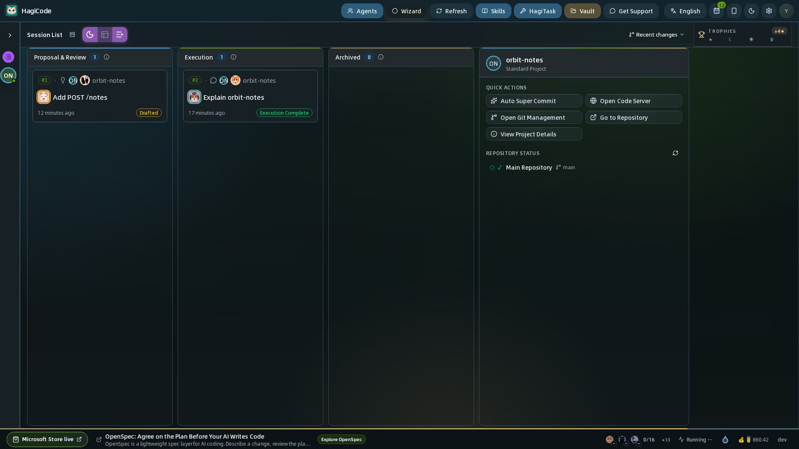

---

## Коротко

- **Основные Agent CLI** в одной рабочей среде: Claude Code, Codex, GitHub Copilot, OpenCode и другие. Полный перечень — в [списке поддерживаемых](https://docs.hagicode.com/ru-RU/related-software-installation/ai-agent-cli/).
- **Windows, macOS и Linux** — как настольное приложение или как контейнер на вашем сервере.
- **Основные функции бесплатны.** Desktop, Container и Microsoft Store — это три способа получить HagiCode, а не три платных тарифа.
- **По умолчанию только чтение.** Обычная сессия лишь читает ваш код; переключитесь в режим правки, когда нужны изменения.

## Начало работы

**1. Выберите, где запускать.**

| Вы работаете на | Выберите | Нужно на хосте | |
| --- | --- | --- | --- |
| Windows | **Microsoft Store** | Node.js 24+ и Git | [Получить](https://apps.microsoft.com/detail/9N3PM0N3SVDW) |
| macOS, Linux или Windows без Store | **Desktop** | Node.js 24+ и Git | [Скачать](https://hagicode.com/desktop/) |
| Сервер, NAS или команда | **Container** (Docker Compose) | Docker. Node.js и Git не нужны | [Развернуть](https://hagicode.com/container/) |

Пошаговые инструкции — в [руководстве по установке](https://docs.hagicode.com/ru-RU/installation/).

**2. Настройка.** Пройдите [мастер первого запуска](https://docs.hagicode.com/ru-RU/quick-start/wizard-setup/) и создайте хотя бы один проект.

**3. Начните сессию.** Сначала откройте [обычную сессию](https://docs.hagicode.com/ru-RU/quick-start/conversation-session/) только для чтения, чтобы разобраться в проекте. Когда будете готовы менять код, переключитесь в режим правки или начните [сессию предложения](https://docs.hagicode.com/ru-RU/quick-start/proposal-session/).

## Как проходит задача разработки

1. **Сначала понять.** Проанализируйте существующий код в обычной сессии только для чтения.
2. **Определить границы.** Для сложных изменений выберите проект и репозитории в сессии предложения и договоритесь о целях, задачах и проверке до того, как что-либо будет изменено.
3. **Выполнить.** Переключитесь в режим правки и работайте по согласованным целям, задачам и проверке.
4. **Проверить и сохранить контекст.** Просматривайте сессии и состояние выполнения в рабочей среде и поручите AI Compose Commit упорядочить коммиты. Предложения и записи о коммитах остаются доступны позже, а MonoSpecs координирует изменения сразу в нескольких репозиториях.

  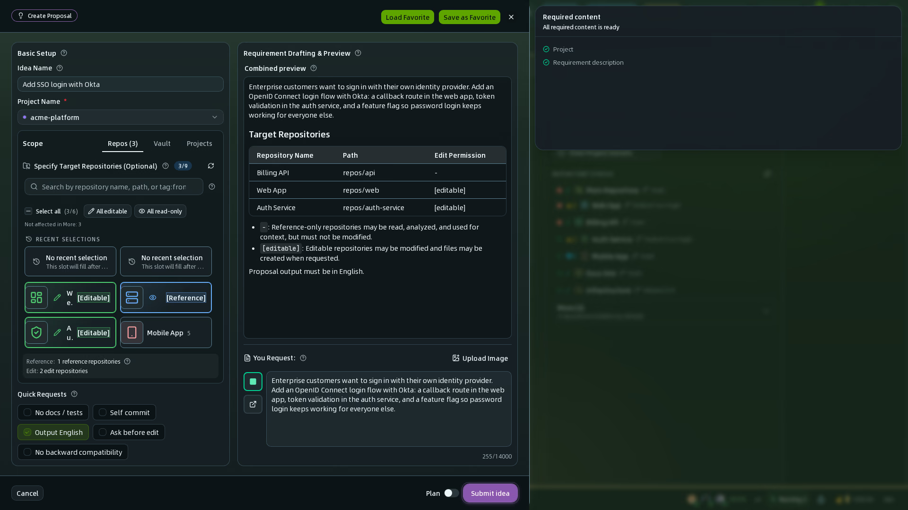
  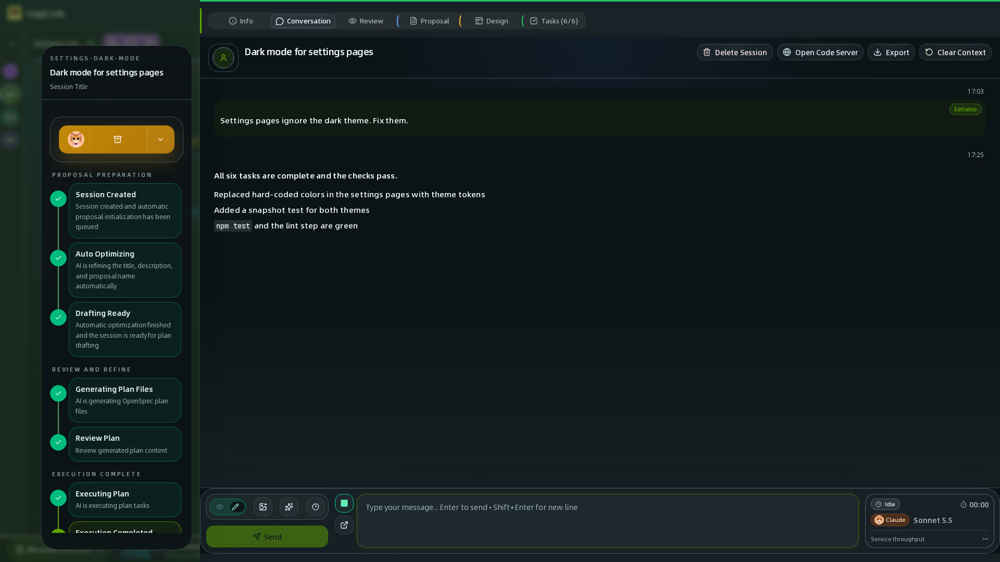

Предложение нужно не каждый раз. Для быстрого вопроса о коде начните с обычной сессии.

## Почему HagiCode

- **Разработка с ИИ на основе предложений**: `OpenSpec` связывает границы работы, задачи, анализ влияния, проверку и выполнение, чтобы сложная работа не превращалась в правки вслепую.
- **Ваши Agent CLI и модели**: CLI и модель выбираются отдельно, так что вы не привязаны к одному набору по умолчанию.
- **Полноценное рабочее место разработчика**: `MonoSpecs` — границы работы в нескольких репозиториях, `Skills` — устанавливаемые расширения, `Vault` — знания для повторного использования, `AI Compose Commit` и `code-server` — чтобы завершить работу в том же месте.
- **Игровая обратная связь на реальных сигналах**: достижения, ежедневные отчёты, коэффициенты эффективности и пропускная способность токенов делают долгую работу с ИИ нагляднее. Это часть рабочей среды, и её можно игнорировать.

  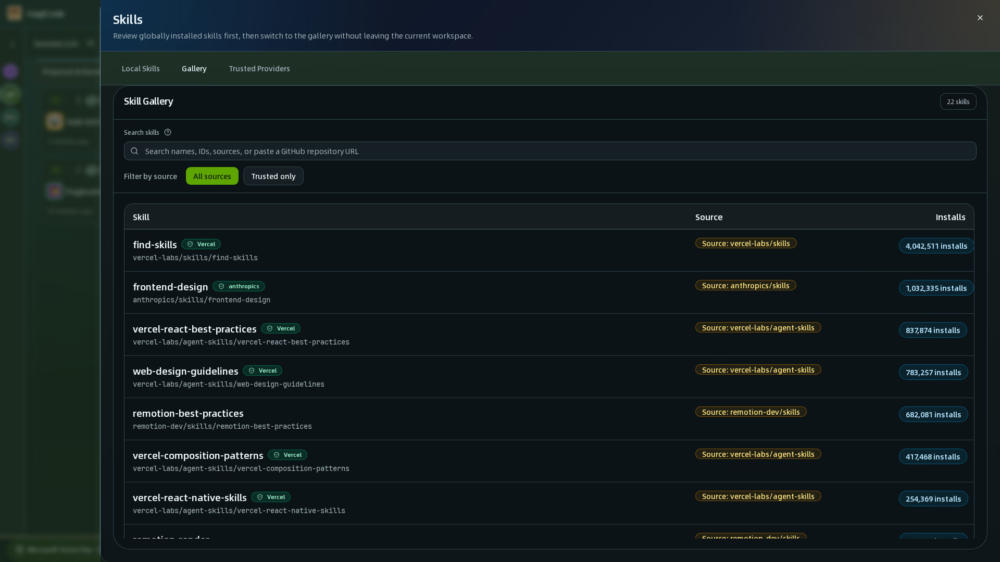

  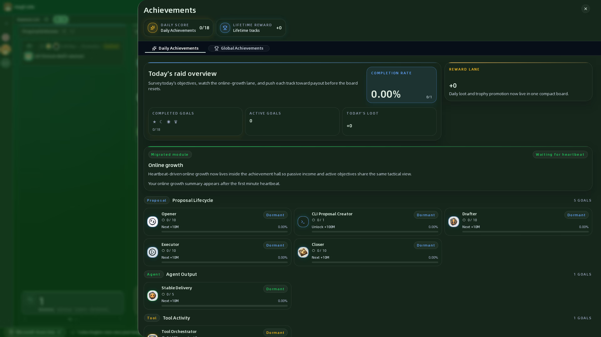

## Обзор рабочего пространства

  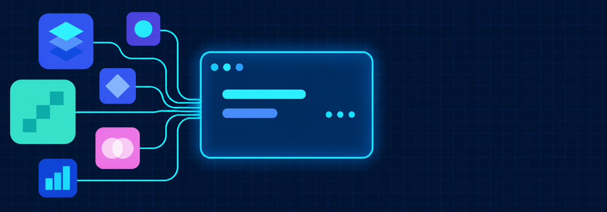

  

Сессии расположены на одной доске по этапам. Карточка показывает, на каком она шаге: черновик, выполняется, ждёт ответа или завершена.

<picture>
  <source media="(prefers-color-scheme: dark)" srcset="./assets/session-statuses-ru-RU-dark.svg" />
  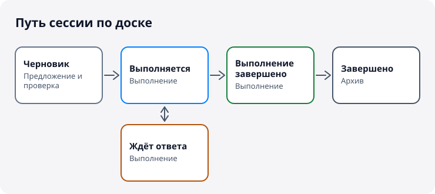
</picture>

  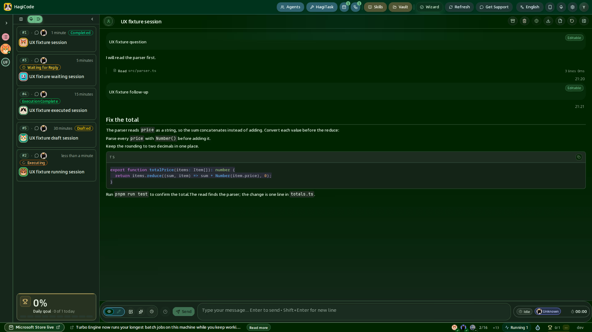

Обычная сессия отвечает на вопросы о вашем коде. Каждый прочитанный файл появляется в ходе диалога, так что можно проверить, откуда взят ответ.

  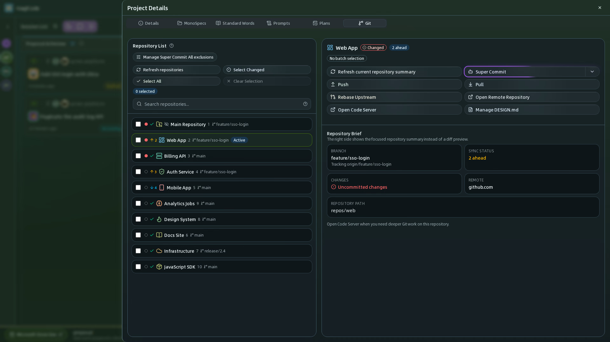

Выберите несколько репозиториев одного проекта и запустите Super Commit для них со вкладки Git.

<picture>
  <source media="(prefers-color-scheme: dark)" srcset="./assets/super-commit-ru-RU-dark.svg" />
  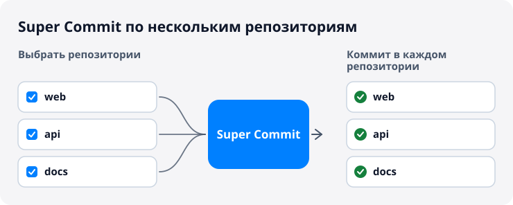
</picture>

  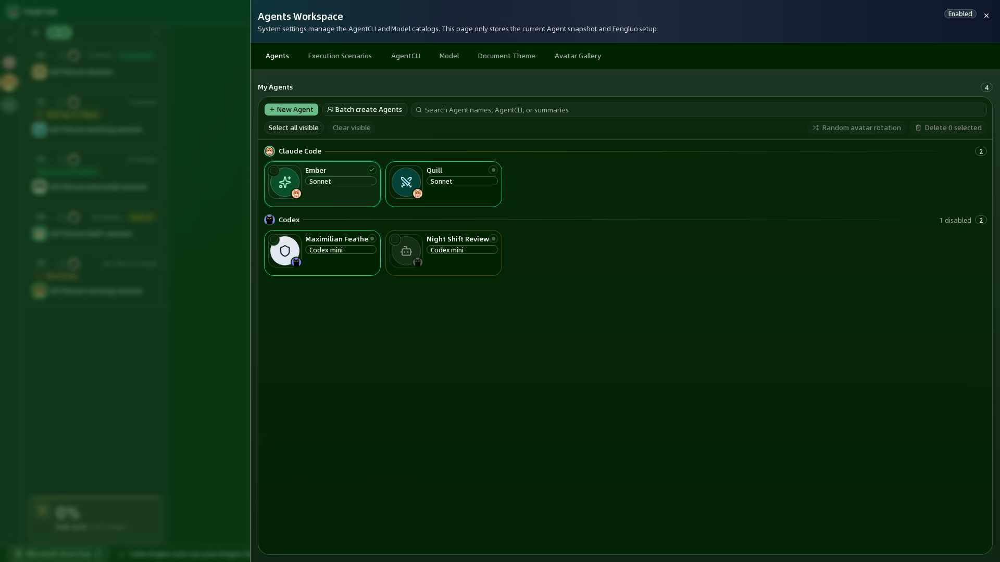

Агенты сгруппированы по Agent CLI, и у каждого показана используемая модель.

  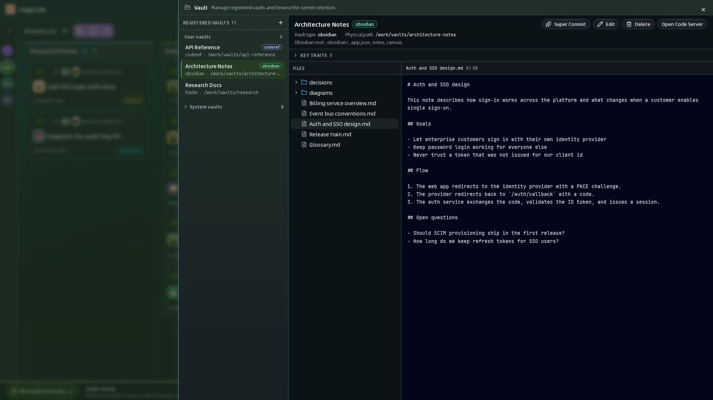

Vault хранит вместе репозитории-справочники и заметки; файлы можно просматривать прямо из рабочего пространства.

  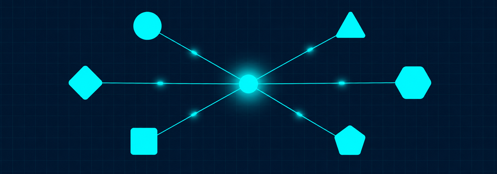

## Интегрированные компоненты

Инструменты, на которых построен HagiCode или к которым он подключается. Большинство из них необязательны и включаются по мере необходимости. На вкладке «Настройки → Интеграция» собраны Git, GitHub, TokenMonitor и Code Server.

| Область | Компонент | Что делает в HagiCode |
| --- | --- | --- |
| **Агенты и модели** | [Agent CLI](https://docs.hagicode.com/ru-RU/related-software-installation/ai-agent-cli/) | Claude Code, Codex, GitHub Copilot, OpenCode и другие работают прямо в рабочей среде. |
| **Спецификации и границы работы** | [OpenSpec](https://docs.hagicode.com/ru-RU/related-software-installation/openspec/intro-openspec/) | Процесс на основе предложений, который связывает границы работы, задачи, проверку и выполнение. |
|  | [MonoSpecs](https://docs.hagicode.com/ru-RU/guides/monospecs/) | Управляет связями между репозиториями и границами изменений в нескольких репозиториях. |
| **Код и контроль версий** | [Git](https://docs.hagicode.com/ru-RU/user-guide/settings/#git) | Профили Git задают явного автора для AI-коммитов. Мониторинг состояния активных проектов — по желанию. |
|  | [GitHub](https://docs.hagicode.com/ru-RU/user-guide/settings/#github) | Использует вашу локальную сессию `gh` для синхронизации сессий и импорта данных GitHub. Токен хранится только в памяти. |
|  | [code-server](https://docs.hagicode.com/ru-RU/user-guide/settings/#code-server) | Точка входа для правки в браузере: можно закончить изменение, не покидая рабочую среду. В настройках его конфигурация и состояние показаны только для чтения. |
| **Знания и расширения** | [Vault](https://docs.hagicode.com/ru-RU/user-guide/vault/) | Собирает справочные репозитории, папки и заметки для повторного использования в дальнейшей работе. |
|  | [Skills и HagiTask](https://docs.hagicode.com/ru-RU/guides/skills/) | Просматривайте галерею навыков и устанавливайте навыки, а также устанавливайте пресеты HagiTask из галереи сообщества. |
| **Ввод и обратная связь** | [TokenMonitor](https://docs.hagicode.com/ru-RU/user-guide/settings/#tokenmonitor) | Показывает в строке состояния сегодняшний расход токенов и стоимость из настольного приложения TokenMonitor. Укажите адрес и секрет HostHub, чтобы обновления приходили почти в реальном времени. |
|  | [Голосовой ввод Doubao](https://docs.hagicode.com/ru-RU/guides/voice-recognition/doubao/) | Диктуйте предложения, комментарии и сообщения сессии с помощью распознавания речи Doubao (豆包). |

## Для кого

- **Подойдёт:** разработчикам и командам, которые ведут несколько репозиториев и хотят планировать сложные изменения до запуска, а также тем, кто уже использует Claude Code, Codex или другой Agent CLI и хочет собрать их в одной рабочей среде.
- **Не обязательно:** если вам нужно лишь несколько строк автодополнения в редакторе, хватит и текущих инструментов.

## Дополнения

Подробности о Plus и DLC — на сайте документации. Основное приложение в Steam снято с публикации; см. [FAQ о статусе Steam](https://docs.hagicode.com/faq/steam-distribution-status/).

- [Hagicode Plus](https://docs.hagicode.com/bundles/hagicode-plus/) — пакет и рекомендации по обновлению
- [Turbo Engine DLC](https://docs.hagicode.com/dlc/turbo-engine-dlc/) — больше параллельных предложений, а также темы документов, собственная подпись, брендинг и аватары (Microsoft Store, разовая покупка)

## Избранные проекты

- **[site](https://github.com/HagiCode-org/site)** - Официальный маркетинговый сайт и публичный стартовый репозиторий на GitHub
- **[desktop](https://github.com/HagiCode-org/desktop)** - Настольный клиент для локальных сценариев HagiCode
- **[container](https://github.com/HagiCode-org/container)** - Развёртывание на собственных серверах для команд и серверных сред
- **[docs](https://github.com/HagiCode-org/docs)** - Сайт документации с эталонным обзором продукта и руководствами

## Пакеты npm

| Пакет | Назначение | npm |
| --- | --- | --- |
| [`@hagicode/cli`](https://www.npmjs.com/package/@hagicode/cli) | Управление проектами, предложениями, хранилищами Vault, чатом и AutoTask из терминала. |  |
| [`@hagicode/hagiscript`](https://www.npmjs.com/package/@hagicode/hagiscript) | Инструменты языка Hagiscript и управление средой выполнения. |  |
| [`@hagicode/hagi18n`](https://www.npmjs.com/package/@hagicode/hagi18n) | Аудит, синхронизация и управление ресурсами локализации. |  |
| [`@hagicode/skillsbase`](https://www.npmjs.com/package/@hagicode/skillsbase) | Создание и сопровождение управляемых репозиториев навыков агента. |  |
| [`@hagicode/hagitask`](https://www.npmjs.com/package/@hagicode/hagitask) | Офлайн-схемы пакетов HagiTask, API валидации и CLI. |  |
| [`@hagicode/hagiscript-sdk`](https://www.npmjs.com/package/@hagicode/hagiscript-sdk) | SDK для API среды выполнения и управления серверами Hagiscript. |  |
| [`@hagicode/steamworks.js`](https://www.npmjs.com/package/@hagicode/steamworks.js) | Привязки Node.js и Electron к Steamworks SDK: Workshop, достижения, статистика, облако, оверлей, сеть. |  |
| [`@hagicode/steamworks-js-cli`](https://www.npmjs.com/package/@hagicode/steamworks-js-cli) | Публикация, обновление и просмотр элементов Steam Workshop из терминала через запущенный клиент Steam. |  |
| [`@hagicode/hagi-release-drafter`](https://www.npmjs.com/package/@hagicode/hagi-release-drafter) | Составное действие GitHub, которое формирует черновик следующего стабильного релиза по Conventional Commits; никогда не публикует. |  |
| [`@hagicode/hagilight`](https://www.npmjs.com/package/@hagicode/hagilight) | Интеграции и компоненты Astro для сайтов HagiCode. |  |
| [`@hagicode/hagilight-core`](https://www.npmjs.com/package/@hagicode/hagilight-core) | Общие утилиты TypeScript, компоненты и ресурсы для сайтов HagiCode на Astro и Starlight. |  |
| [`@hagicode/hagilight-starlight`](https://www.npmjs.com/package/@hagicode/hagilight-starlight) | Плагин и компоненты Starlight для документации HagiCode. |  |
| [`@hagicode/hagilight-docusaurus`](https://www.npmjs.com/package/@hagicode/hagilight-docusaurus) | Плагин Docusaurus для функций сайта HagiCode: подвал, аналитика, SEO, карта сайта, RSS. |  |
| [`@hagicode/hagilight-mermaid`](https://www.npmjs.com/package/@hagicode/hagilight-mermaid) | Не зависящий от фреймворка рендеринг Mermaid в стиле HagiCode для сайтов Astro, Starlight и Docusaurus. |  |

## Поддержка

- [Документация](https://docs.hagicode.com/ru-RU/)
- [Блог](https://docs.hagicode.com/ru-RU/blog/)
- [Организация на GitHub](https://github.com/HagiCode-org)
- [Issues](https://github.com/HagiCode-org/site/issues)
- [Калькулятор замены ИИ](https://cost.hagicode.com)

Хотите узнать о продукте больше? Начните с [hagicode.com](https://hagicode.com/) и выберите путь, который подходит вашему процессу.
