# HagiCode

  <a href="./README.md">English</a> ·
  <a href="./README.zh-CN.md">简体中文</a> ·
  <a href="./README.zh-Hant.md">繁體中文</a> ·
  <a href="./README.ja-JP.md">日本語</a> ·
  <a href="./README.ko-KR.md">한국어</a> ·
  <a href="./README.de-DE.md">Deutsch</a> ·
  <a href="./README.fr-FR.md">Français</a> ·
  <a href="./README.es-ES.md">Español</a> ·
  <a href="./README.pt-BR.md">Português (Brasil)</a> ·
  <a href="./README.ru-RU.md">Русский</a>

<strong>HagiCode 让 AI 改代码时不丢上下文：先读懂仓库，再划清范围，最后可追踪地执行。</strong>

面向项目开发的 AI 工作台。它接入你已有的 Agent CLI 和模型，不需要换编辑器。

<picture>
  <source media="(prefers-color-scheme: dark)" srcset="./assets/hero-flow-zh-CN-dark.svg" />
  
</picture>

  <a href="https://docs.hagicode.com/installation/"><strong>安装指南</strong></a>
  ·
  <a href="https://docs.hagicode.com/product-overview/">产品概览</a>
  ·
  <a href="https://hagicode.com/">官网</a>
  ·
  <a href="https://apps.microsoft.com/detail/9N3PM0N3SVDW">Microsoft Store</a>
  ·
  <a href="https://docs.hagicode.com/blog/">博客</a>

---

## 一眼看懂

- **主流 Agent CLI**，同一个工作台，如 Claude Code、Codex、GitHub Copilot、OpenCode 等，完整列表见[支持范围](https://docs.hagicode.com/related-software-installation/ai-agent-cli/)。
- **Windows、macOS、Linux 均可使用**，可选桌面版或自托管容器。
- **基础功能免费。** Desktop、Container、Microsoft Store 是三种获取方式，不是三档付费版本。
- **默认只读。** 普通会话只分析代码，需要修改时再切换到编辑模式。

## 开始使用

**1. 选择运行方式。**

| 你的环境 | 选择 | 本机需要 | |
| --- | --- | --- | --- |
| Windows | **Microsoft Store** | Node.js 24+ 和 Git | [前往获取](https://apps.microsoft.com/detail/9N3PM0N3SVDW) |
| macOS、Linux，或无法使用商店的 Windows | **Desktop 桌面版** | Node.js 24+ 和 Git | [下载](https://hagicode.com/desktop/) |
| 服务器、NAS 或团队 | **Container 容器版**（Docker Compose） | Docker，无需 Node.js 和 Git | [部署](https://hagicode.com/container/) |

详细步骤见[安装指南](https://docs.hagicode.com/installation/)。

**2. 初始化。** 完成[首次启动向导](https://docs.hagicode.com/quick-start/wizard-setup/)，并创建至少一个项目。

**3. 开始会话。** 先用只读的[普通会话](https://docs.hagicode.com/quick-start/conversation-session/)理解项目；准备好修改代码时，再切换到编辑模式，或开启[提案会话](https://docs.hagicode.com/quick-start/proposal-session/)。

## 一次开发任务怎么走

1. **先理解**：在只读的普通会话中分析现有代码。
2. **再定范围**：复杂变更在提案会话中选择项目和仓库，先对齐目标、任务与验证方式，再动手修改。
3. **后执行**：切换到编辑模式，按已对齐的目标、任务与验证方式推进。
4. **回看并留下上下文**：在工作台检查会话与执行状态，用 AI Compose Commit 整理提交；提案与提交记录可供回顾，跨仓库协作交给 MonoSpecs 管理。

  
  

不必每次都走提案流程：只想了解代码或处理简单问题时，从普通会话开始即可。

## 为什么选择 HagiCode

- **提案驱动的 AI 编码**：`OpenSpec` 把范围、任务、影响分析、验证与执行连成一条链路，而不是让复杂工作退化成盲改。
- **自带 Agent CLI 与模型**：`OmniRoute` 把 CLI 的选择与模型、订阅层分开，路由模型和端点时不必绑定在某一套默认组合上。
- **完整的开发工作区**：`MonoSpecs` 管理多仓范围，`Skills` 提供可安装的扩展，`Vault` 沉淀可复用知识，`AI Compose Commit` 与 `code-server` 让收尾也在同一处完成。
- **带有真实信号的游戏化反馈**：成就、日报、效率倍率与 token 吞吐量，让长期 AI 协作更容易读懂。这是工作台体验的一部分，不想用可以忽略。

  
  

  

## 集成组件

HagiCode 所依托或接入的工具。大多数是可选的，需要时再开启。设置里的“集成”标签页集中放了 Git、GitHub、OmniRoute、TokenMonitor 和 Code Server。

| 领域 | 组件 | 在 HagiCode 里做什么 |
| --- | --- | --- |
| **Agent 与模型** | [Agent CLI](https://docs.hagicode.com/zh-CN/related-software-installation/ai-agent-cli/) | Claude Code、Codex、GitHub Copilot、OpenCode 等直接在工作台里运行。 |
|  | [OmniRoute](https://docs.hagicode.com/zh-CN/related-software-installation/omniroute/) | 共享的模型网关。设置端点，并选择哪些 Agent CLI 使用它的模型目录。 |
| **规范与范围** | [OpenSpec](https://docs.hagicode.com/zh-CN/related-software-installation/openspec/intro-openspec/) | 提案驱动的工作流，把范围、任务、验证和执行连成一条链路。 |
|  | [MonoSpecs](https://docs.hagicode.com/zh-CN/guides/monospecs/) | 管理多个仓库之间的关系与变更范围。 |
| **代码与版本控制** | [Git](https://docs.hagicode.com/zh-CN/user-guide/settings/#git) | Git Profile 为 AI 提交指定明确的作者；可选地监控活跃项目的 Git 状态。 |
|  | [GitHub](https://docs.hagicode.com/zh-CN/user-guide/settings/#github) | 复用本机的 `gh` 登录会话来同步会话、导入 GitHub 数据；令牌只保留在内存中。 |
|  | [code-server](https://docs.hagicode.com/zh-CN/user-guide/settings/#code-server) | 浏览器中的编辑入口，不离开工作台就能完成修改。设置页以只读方式显示它的配置和运行状态。 |
| **知识与扩展** | [Vault](https://docs.hagicode.com/zh-CN/user-guide/vault/) | 汇集参考仓库、文件夹和笔记，供后续工作复用。 |
|  | [Skills 与 HagiTask](https://docs.hagicode.com/zh-CN/guides/skills/) | 浏览技能画廊并安装技能，或从社区画廊安装 HagiTask 预设。 |
| **输入与反馈** | [TokenMonitor](https://docs.hagicode.com/zh-CN/user-guide/settings/#tokenmonitor) | 在状态栏显示 TokenMonitor 桌面应用统计的今日 token 用量和费用；填写 HostHub 地址和密钥可获得近实时更新。 |
|  | [豆包语音输入](https://docs.hagicode.com/zh-CN/guides/voice-recognition/doubao/) | 通过豆包语音识别，用语音输入提案、批注和会话消息。 |

## 适合谁

- **适合**：同时维护多个仓库、希望复杂改动先规划再执行的开发者和团队；已经在用 Claude Code、Codex 等 Agent CLI，想把它们放进同一个工作台的人。
- **不是必需品**：如果你只需要在编辑器里补全几行代码，现有工具已经够用。

## 增强内容

Plus 与 DLC 的详情在文档站。Steam 主应用已退役，详见 [Steam 分发状态](https://docs.hagicode.com/faq/steam-distribution-status/)。

- [Hagicode Plus](https://docs.hagicode.com/bundles/hagicode-plus/) — 套装与升级指引
- [Turbo Engine DLC](https://docs.hagicode.com/dlc/turbo-engine-dlc/) — 更高的提案并发上限，以及文档主题、自定义署名、品牌和头像（Microsoft Store 一次性购买）

## 精选项目

- **[site](https://github.com/HagiCode-org/site)** - 官方营销网站与公开 GitHub 落地仓库
- **[desktop](https://github.com/HagiCode-org/desktop)** - 面向本地优先 HagiCode 工作流的桌面客户端
- **[container](https://github.com/HagiCode-org/container)** - 面向团队与服务器环境的自托管部署方案
- **[docs](https://github.com/HagiCode-org/docs)** - 提供规范产品概览与指南的文档站点

## 命令行工具

| 软件包 | 用途 | npm |
| --- | --- | --- |
| [`@hagicode/cli`](https://www.npmjs.com/package/@hagicode/cli) | 在终端管理项目、提案、Vault、对话与 AutoTask。 |  |
| [`@hagicode/hagiscript`](https://www.npmjs.com/package/@hagicode/hagiscript) | Hagiscript 语言工具与运行时管理。 |  |
| [`@hagicode/hagi18n`](https://www.npmjs.com/package/@hagicode/hagi18n) | 审计、同步和管理多语言资源。 |  |
| [`@hagicode/imgbin`](https://www.npmjs.com/package/@hagicode/imgbin) | 生成、标注并索引图片资源。 |  |
| [`@hagicode/skillsbase`](https://www.npmjs.com/package/@hagicode/skillsbase) | 初始化并维护受管理的 Agent 技能仓库。 |  |

## 支持

- [文档](https://docs.hagicode.com/)
- [博客](https://docs.hagicode.com/blog/)
- [GitHub 组织](https://github.com/HagiCode-org)
- [问题反馈](https://github.com/HagiCode-org/site/issues)
- [AI 替代率计算器](https://cost.hagicode.com)

准备好继续了解完整产品故事了吗？从 [hagicode.com](https://hagicode.com/) 开始，选择最适合你工作流的入口。
