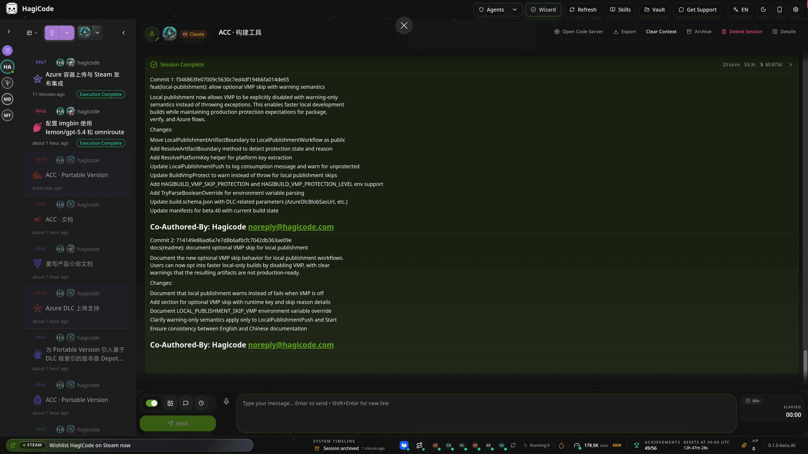
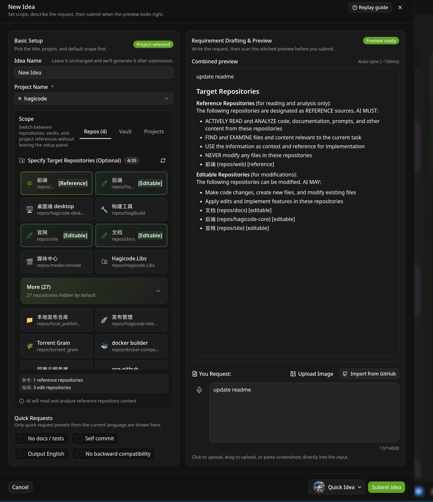
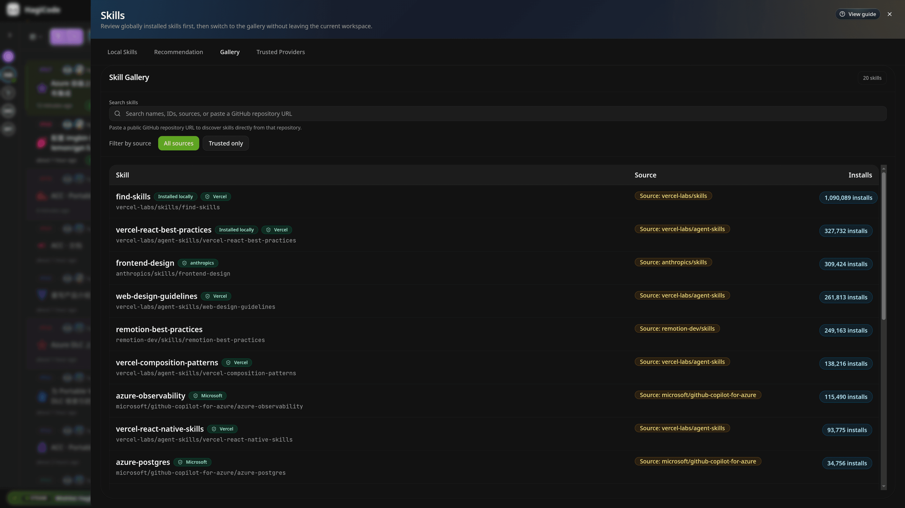

# HagiCode

  <a href="./README.md">English</a> ·
  <a href="./README.zh-CN.md">简体中文</a> ·
  <a href="./README.zh-Hant.md">繁體中文</a> ·
  <a href="./README.ja-JP.md">日本語</a> ·
  <a href="./README.ko-KR.md">한국어</a> ·
  <a href="./README.de-DE.md">Deutsch</a> ·
  <a href="./README.fr-FR.md">Français</a> ·
  <a href="./README.es-ES.md">Español</a> ·
  <a href="./README.pt-BR.md">Português (Brasil)</a> ·
  <a href="./README.ru-RU.md">Русский</a>

<strong>HagiCode 讓 AI 修改程式碼時不遺失上下文：先讀懂儲存庫，再劃清範圍，最後以可追蹤的方式執行。</strong>

面向專案開發的 AI 工作台。它能接入你已有的 Agent CLI 與模型，不需要更換編輯器。

<picture>
  <source media="(prefers-color-scheme: dark)" srcset="./assets/hero-flow-zh-Hant-dark.svg" />
  
</picture>

  <a href="https://docs.hagicode.com/zh-Hant/installation/"><strong>安裝指南</strong></a>
  ·
  <a href="https://docs.hagicode.com/zh-Hant/product-overview/">產品概覽</a>
  ·
  <a href="https://hagicode.com/">官網</a>
  ·
  <a href="https://apps.microsoft.com/detail/9N3PM0N3SVDW">Microsoft Store</a>
  ·
  <a href="https://docs.hagicode.com/zh-Hant/blog/">部落格</a>

---

## 一眼看懂

- **主流 Agent CLI**，同一個工作台，如 Claude Code、Codex、GitHub Copilot、OpenCode 等，完整清單見[支援範圍](https://docs.hagicode.com/zh-Hant/related-software-installation/ai-agent-cli/)。
- **Windows、macOS、Linux 皆可使用**，可選桌面版或自行託管的容器。
- **基礎功能免費。** Desktop、Container、Microsoft Store 是三種取得方式，不是三檔付費版本。
- **預設唯讀。** 一般工作階段只分析程式碼，需要修改時再切換到編輯模式。

## 開始使用

**1. 選擇執行方式。**

| 你的環境 | 選擇 | 本機需要 | |
| --- | --- | --- | --- |
| Windows | **Microsoft Store** | Node.js 24+ 和 Git | [前往取得](https://apps.microsoft.com/detail/9N3PM0N3SVDW) |
| macOS、Linux，或無法使用商店的 Windows | **Desktop 桌面版** | Node.js 24+ 和 Git | [下載](https://hagicode.com/desktop/) |
| 伺服器、NAS 或團隊 | **Container 容器版**（Docker Compose） | Docker，無需 Node.js 和 Git | [部署](https://hagicode.com/container/) |

詳細步驟見[安裝指南](https://docs.hagicode.com/zh-Hant/installation/)。

**2. 初始化。** 完成[首次啟動精靈](https://docs.hagicode.com/zh-Hant/quick-start/wizard-setup/)，並建立至少一個專案。

**3. 開始工作階段。** 先用唯讀的[一般工作階段](https://docs.hagicode.com/zh-Hant/quick-start/conversation-session/)理解專案；準備好修改程式碼時，再切換到編輯模式，或開啟[提案工作階段](https://docs.hagicode.com/zh-Hant/quick-start/proposal-session/)。

## 一次開發任務怎麼走

1. **先理解**：在唯讀的一般工作階段中分析現有程式碼。
2. **再定範圍**：複雜變更在提案工作階段中選擇專案和儲存庫，先對齊目標、任務與驗證方式，再動手修改。
3. **後執行**：切換到編輯模式，按已對齊的目標、任務與驗證方式推進。
4. **回看並留下上下文**：在工作台檢查工作階段與執行狀態，用 AI Compose Commit 整理提交；提案與提交紀錄可供回顧，跨儲存庫協作交給 MonoSpecs 管理。

  
  

不必每次都走提案流程：只想了解程式碼或處理簡單問題時，從一般工作階段開始即可。

## 為什麼選擇 HagiCode

- **提案驅動的 AI 編碼**：`OpenSpec` 把範圍、任務、影響分析、驗證與執行串成一條鏈路，而不是讓複雜工作退化成盲改。
- **自帶 Agent CLI 與模型**：`OmniRoute` 把 CLI 的選擇與模型、訂閱層分開，路由模型和端點時不必綁定在某一套預設組合上。
- **完整的開發工作區**：`MonoSpecs` 管理多儲存庫範圍，`Skills` 提供可安裝的擴充，`Vault` 沉澱可重複使用的知識，`AI Compose Commit` 與 `code-server` 讓收尾也在同一處完成。
- **帶有真實訊號的遊戲化回饋**：成就、日報、效率倍率與 token 吞吐量，讓長期 AI 協作更容易讀懂。這是工作台體驗的一部分，不想用可以忽略。

  
  

  

## 整合元件

HagiCode 所依託或接入的工具。大多數是選用的，需要時再開啟。設定裡的「整合」分頁集中放了 Git、GitHub、OmniRoute、TokenMonitor 和 Code Server。

| 領域 | 元件 | 在 HagiCode 裡做什麼 |
| --- | --- | --- |
| **Agent 與模型** | [Agent CLI](https://docs.hagicode.com/zh-Hant/related-software-installation/ai-agent-cli/) | Claude Code、Codex、GitHub Copilot、OpenCode 等直接在工作台裡執行。 |
|  | [OmniRoute](https://docs.hagicode.com/zh-Hant/related-software-installation/omniroute/) | 共用的模型閘道。設定端點，並選擇哪些 Agent CLI 使用它的模型目錄。 |
| **規格與範圍** | [OpenSpec](https://docs.hagicode.com/zh-Hant/related-software-installation/openspec/intro-openspec/) | 提案驅動的工作流程，把範圍、任務、驗證和執行串成一條鏈路。 |
|  | [MonoSpecs](https://docs.hagicode.com/zh-Hant/guides/monospecs/) | 管理多個儲存庫之間的關係與變更範圍。 |
| **程式碼與版本控制** | [Git](https://docs.hagicode.com/zh-Hant/user-guide/settings/#git) | Git Profile 為 AI 提交指定明確的作者；可選擇性地監控活躍專案的 Git 狀態。 |
|  | [GitHub](https://docs.hagicode.com/zh-Hant/user-guide/settings/#github) | 重複使用本機的 `gh` 登入工作階段來同步工作階段、匯入 GitHub 資料；權杖只保留在記憶體中。 |
|  | [code-server](https://docs.hagicode.com/zh-Hant/user-guide/settings/#code-server) | 瀏覽器中的編輯入口，不離開工作台就能完成修改。設定頁以唯讀方式顯示它的設定和執行狀態。 |
| **知識與擴充** | [Vault](https://docs.hagicode.com/zh-Hant/user-guide/vault/) | 匯集參考儲存庫、資料夾和筆記，供後續工作重複使用。 |
|  | [Skills 與 HagiTask](https://docs.hagicode.com/zh-Hant/guides/skills/) | 瀏覽技能圖庫並安裝技能，或從社群圖庫安裝 HagiTask 預設。 |
| **輸入與回饋** | [TokenMonitor](https://docs.hagicode.com/zh-Hant/user-guide/settings/#tokenmonitor) | 在狀態列顯示 TokenMonitor 桌面應用程式統計的今日 token 用量和費用；填寫 HostHub 位址和密鑰可獲得近即時更新。 |
|  | [豆包語音輸入](https://docs.hagicode.com/zh-Hant/guides/voice-recognition/doubao/) | 透過豆包語音辨識，用語音輸入提案、註解和工作階段訊息。 |

## 適合誰

- **適合**：同時維護多個儲存庫、希望複雜改動先規劃再執行的開發者和團隊；已經在用 Claude Code、Codex 等 Agent CLI，想把它們放進同一個工作台的人。
- **不是必需品**：如果你只需要在編輯器裡補全幾行程式碼，現有工具已經夠用。

## 加值內容

Plus 與 DLC 的詳情在文件站。Steam 主應用程式已退役，詳見 [Steam 發行狀態](https://docs.hagicode.com/faq/steam-distribution-status/)。

- [Hagicode Plus](https://docs.hagicode.com/bundles/hagicode-plus/) — 套裝與升級指引
- [Turbo Engine DLC](https://docs.hagicode.com/dlc/turbo-engine-dlc/) — 更高的提案並行上限，以及文件主題、自訂署名、品牌和頭像（Microsoft Store 一次性購買）

## 精選專案

- **[site](https://github.com/HagiCode-org/site)** - 官方行銷網站與公開 GitHub 落地儲存庫
- **[desktop](https://github.com/HagiCode-org/desktop)** - 面向本地優先 HagiCode 工作流程的桌面用戶端
- **[container](https://github.com/HagiCode-org/container)** - 面向團隊與伺服器環境的自行託管部署方案
- **[docs](https://github.com/HagiCode-org/docs)** - 提供規範產品概覽與指南的文件站點

## 命令列工具

| 套件 | 用途 | npm |
| --- | --- | --- |
| [`@hagicode/cli`](https://www.npmjs.com/package/@hagicode/cli) | 在終端機管理專案、提案、Vault、對話與 AutoTask。 |  |
| [`@hagicode/hagiscript`](https://www.npmjs.com/package/@hagicode/hagiscript) | Hagiscript 語言工具與執行環境管理。 |  |
| [`@hagicode/hagi18n`](https://www.npmjs.com/package/@hagicode/hagi18n) | 稽核、同步和管理多語系資源。 |  |
| [`@hagicode/imgbin`](https://www.npmjs.com/package/@hagicode/imgbin) | 產生、標註並索引圖片資源。 |  |
| [`@hagicode/skillsbase`](https://www.npmjs.com/package/@hagicode/skillsbase) | 初始化並維護受管理的 Agent 技能儲存庫。 |  |

## 支援

- [文件](https://docs.hagicode.com/zh-Hant/)
- [部落格](https://docs.hagicode.com/zh-Hant/blog/)
- [GitHub 組織](https://github.com/HagiCode-org)
- [問題回報](https://github.com/HagiCode-org/site/issues)
- [AI 替代率計算機](https://cost.hagicode.com)

準備好繼續了解完整產品故事了嗎？從 [hagicode.com](https://hagicode.com/) 開始，選擇最適合你工作流程的入口。
